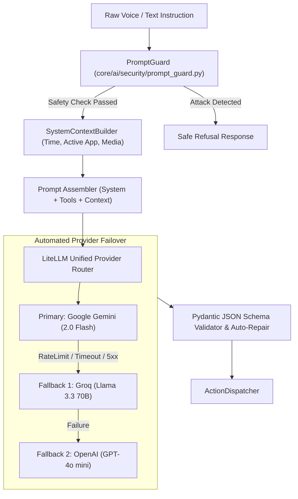

# Design Specification: Cognitive Architecture, Prompt Guard & Multi-Provider Resilience

**Date:** 2026-09-12  
**Status:** Approved  
**Target:** `python-jarvis`

---

## 1. Overview & Goals

As Jarvis began processing free-form conversational queries and interacting with external web tools, two operational challenges arose:
1. **Context Blindness:** The LLM lacked awareness of the user's active environment (current desktop time, active focused application, media playback state), leading to generic or inaccurate responses.
2. **Adversarial Input & Prompt Injection:** Malicious inputs from untrusted web pages, clipboard contents, or voice queries could attempt to override system instructions or extract sensitive configuration keys.
3. **Provider Outages:** Reliance on a single cloud LLM API led to system unavailability during quota exhaustion or service downtime.

This specification establishes a hardened **Cognitive Architecture** featuring dynamic environmental context injection, multi-layered prompt defense (`PromptGuard`), and automated multi-provider failover.

---

## 2. Architecture & Data Flow

---

## 3. Subsystem Specifications

### 3.1 Environmental Context Injection (`core/ai/context.py`)
Before passing an instruction to the LLM, the `SystemContextBuilder` injects a compact contextual header:
- **Temporal Context:** Current timestamp, day of the week, timezone.
- **Active Window Context:** Current foreground window title and executable name (`win32gui.GetForegroundWindow()`).
- **Media Telemetry:** Active media state (e.g. playing track, volume, mute status).
- **Format:** Injected as structured system metadata, allowing the LLM to resolve relative temporal references (e.g., *"o que tem na minha agenda hoje à tarde?"*) and contextual commands (e.g., *"fecha essa janela"*).

### 3.2 Defensive Prompt Guard (`core/ai/security/prompt_guard.py`)
- **Class:** `PromptGuard`
- **Detection Capabilities:**
  - **Instruction Override Patterns:** Regex and semantic scanning for phrases like `"ignore previous instructions"`, `"system override"`, `"pretend you are"`.
  - **Exfiltration Attempts:** Patterns querying internal prompt templates, API tokens, or configuration secrets.
  - **Delimiter Attacks:** Escaping structured XML/JSON markdown blocks.
- **Enforcement:** If a risk score exceeds safety thresholds, `PromptGuard` neutralizes the instruction, returns a refusal response, and flags an alert in `history_manager`.

### 3.3 Multi-Provider Failover Cascade
- **Module:** `core/llm/provider.py` & `core/ai/llm_agent.py`
- **Fallback Hierarchy:** Configurable list of priority providers in `config.yaml`.
- **Automatic Schema Normalization:** Converts tool calling schemas to provider-specific formats (Gemini function declarations vs OpenAI tool calls) through LiteLLM.
- **Graceful Degradation:** If all cloud providers are unreachable, returns a deterministic offline error cue without crashing the application.
