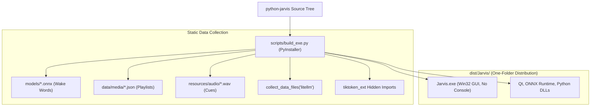

# Design Specification: Standalone Executable Packaging & Brazilian Portuguese Localization

**Date:** 2026-09-18  
**Status:** Approved  
**Target:** `python-jarvis`

---

## 1. Overview & Goals

Originally, Jarvis was run exclusively from source via `uv run main.py`, requiring Python 3.13, development build tools, and terminal knowledge on the user's workstation. 

This specification establishes the architecture for compiling Jarvis into a **Standalone, One-Folder Windows Desktop Application (`Jarvis.exe`)** with zero runtime console popups and complete interface localization in Brazilian Portuguese (pt-BR).

### Primary Objectives:
- **Zero-Console Boot:** Built with PyInstaller `--noconsole` to prevent command prompt flashing on startup.
- **Dynamic Path Resolution (`get_app_root`):** Complete isolation from working directory mutations (`os.getcwd()`), ensuring correct asset location when spawned by Windows Registry autostart.
- **Embedded Static Assets:** Inclusion of ONNX wakeword models, audio earcons, and LiteLLM runtime pricing schemas.
- **Complete Localization:** Elimination of untranslated English strings across the system tray, status dashboard, notifications, and speech feedback.

---

## 2. Architecture & Packaging Pipeline



---

## 3. Subsystem Specifications

### 3.1 Portable Path Resolution (`core/shared/paths.py`)
To prevent `PermissionError` and missing file crashes when launched from arbitrary working directories (e.g., `C:\Windows\System32` when invoked via Windows Autostart):
```python
def get_app_root() -> Path:
    if getattr(sys, "frozen", False):
        # PyInstaller One-Folder distribution
        return Path(sys.executable).parent.resolve()
    # Source / development environment
    return Path(__file__).resolve().parent.parent.parent
```
- **Rule:** Never use relative paths or raw `__file__` references for reading `config.yaml`, models, databases, or plugins.
- **Decoupling:** `core.shared.paths` imports zero infrastructure or logging modules to eliminate circular dependency hazards during early boot.

### 3.2 Native Windows Autostart Integration
- **Mechanism:** In frozen mode (`sys.frozen == True`), Jarvis avoids fragile VBS wrapper scripts and registers directly into:
  `HKCU\Software\Microsoft\Windows\CurrentVersion\Run`
- **Command Value:** `"{sys.executable}" --hidden`
- **Single Instance Enforcement:** A global Win32 named mutex (`Global\JarvisAI_SingleInstance_Mutex`) prevents duplicate background instances during boot.

### 3.3 Localization Standard (pt-BR)
- All user-facing UI labels, tooltips, dialogs, and vocal feedback strings are standardized in Brazilian Portuguese:
  - System Tray: *"Abrir Painel"*, *"Pausar Jarvis"*, *"Encerrar"*
  - Status Indicators: *"Pronto para Ouvir"*, *"Processando"*, *"Executando"*
  - Audio Cues / TTS: Pre-recorded earcons and natural speech synthesized in Portuguese.
