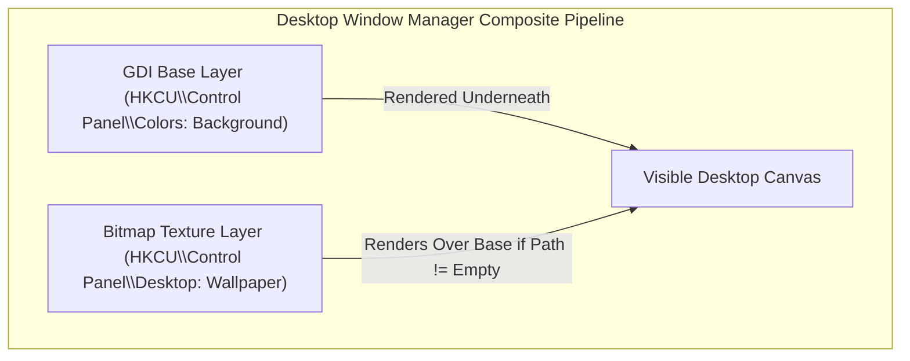

# Technical Specification & Root Cause Analysis: Windows Desktop Wallpaper & Solid Color Concurrency

**Date:** 2026-09-28  
**Status:** Approved  
**Target:** `python-jarvis`

---

## 1. Overview & Problem Description

When toggling between image wallpapers and solid background colors in Windows 10/11, users reported visual race conditions where solid color choices were reverted immediately upon system reboot or failed to clear the existing desktop bitmap.

Investigating the Win32 Desktop Window Manager (DWM) revealed an underlying architectural conflict between the GDI system palette API and the Windows Shell wallpaper caching mechanism.

---

## 2. Technical Root Cause Analysis

### The DWM Multi-Layer Rendering Hierarchy
The Windows desktop background is composed of two distinct rendering layers managed by `explorer.exe`:
1. **The Base Solid Background Layer:** Defined by the `Background` RGB triplet in `HKCU\Control Panel\Colors` and mutated at runtime via `SetSysColors(COLOR_DESKTOP)`.
2. **The Shell Bitmap Wallpaper Layer:** Defined by `HKCU\Control Panel\Desktop\Wallpaper` and updated via `SystemParametersInfo(SPI_SETDESKWALLPAPER)`.



### The Conflict
Calling `SetSysColors(COLOR_DESKTOP)` modifies only the base layer. If `HKCU\Control Panel\Desktop\Wallpaper` points to an existing file path, DWM renders the wallpaper bitmap directly over the solid color canvas. 

Conversely, simply passing an empty string to `SystemParametersInfo(SPI_SETDESKWALLPAPER, 0, "", ...)` without broadcasting system setting updates leaves `WallpaperStyle` and `TileWallpaper` active, causing Windows to display a black screen or distorted cached thumbnail upon the next login.

---

## 3. Implementation Specification

To guarantee resilient solid color transitions and persistent state, the wallpaper controller must execute a synchronized 4-step sequence:

### 3.1 Synchronized Registry Mutation
```python
def set_solid_color(r: int, g: int, b: int) -> None:
    rgb_string = f"{r} {g} {b}"
    
    # 1. Update GDI color entry in registry
    with winreg.OpenKey(winreg.HKEY_CURRENT_USER, r"Control Panel\Colors", 0, winreg.KEY_SET_VALUE) as key:
        winreg.SetValueEx(key, "Background", 0, winreg.REG_SZ, rgb_string)
        
    # 2. Clear shell wallpaper path and reset styling to unscaled
    with winreg.OpenKey(winreg.HKEY_CURRENT_USER, r"Control Panel\Desktop", 0, winreg.KEY_SET_VALUE) as key:
        winreg.SetValueEx(key, "Wallpaper", 0, winreg.REG_SZ, "")
        winreg.SetValueEx(key, "WallpaperStyle", 0, winreg.REG_SZ, "0")
        winreg.SetValueEx(key, "TileWallpaper", 0, winreg.REG_SZ, "0")
```

### 3.2 Win32 API Signal & System Broadcast
Following registry persistence:
1. `ctypes.windll.user32.SetSysColors(1, ctypes.byref(COLOR_DESKTOP), ctypes.byref(color_ref))` applies the color immediately to the active display session without requiring an Explorer restart.
2. `SystemParametersInfoW(SPI_SETDESKWALLPAPER, 0, "", SPIF_UPDATEINIFILE | SPIF_SENDCHANGE)` instructs the Windows Shell to unmap cached texture surfaces.
3. `PostMessage(HWND_BROADCAST, WM_SETTINGCHANGE, SPI_SETDESKWALLPAPER, 0)` notifies active shell extensions and virtual desktops.
