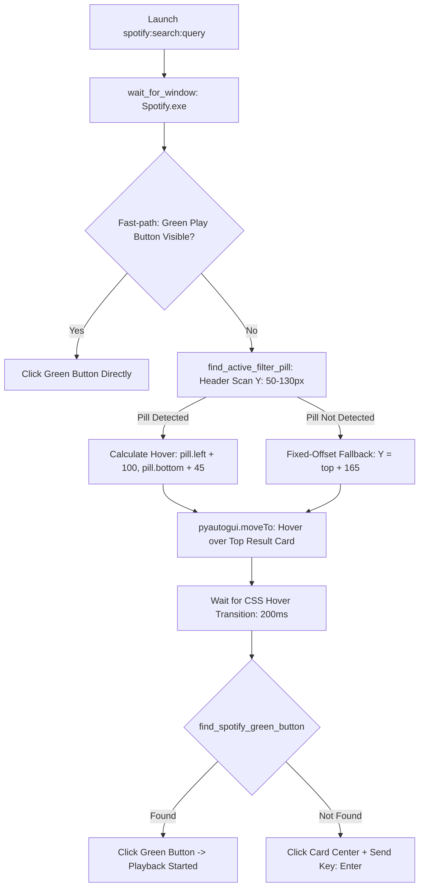

# Design Specification: Spotify Desktop Search Autoplay & Dynamic UI Adaptation

**Date:** 2026-10-06  
**Status:** Approved  
**Target:** `python-jarvis`

---

## 1. Overview & Goals

When processing voice commands to play tracks or artists (e.g. *"tocar Daft Punk"*), Jarvis opens the Spotify desktop client via URI protocol `spotify:search:<encoded_query>` and automates track playback (`click_type="search"`).

A recent Spotify Desktop client release broke the legacy automation pipeline:
1. **Anchor Removal:** The textual header `"Melhor resultado"` / `"Top result"` was completely removed from the DOM, causing legacy OpenCV template matching (`spotify_search_anchor.png`) to fail permanently.
2. **Ratio-Based Fallback Inaccuracy:** The previous fallback used a static vertical ratio `search_y_ratio = 0.35`. Because Spotify's top navigation has a fixed pixel height (~104px), scaling with window height placed the hover cursor far below the top result card (e.g., Y=378 on 1080p windows, whereas the card sits between Y=125 and Y=225).
3. **Failure Cascade:** Without hovering over the result card, Spotify does not render the floating green play button, causing click routines to miss and fallback into random keyboard tabs.

This specification details a robust, OCR-free **Dynamic Filter Pill Detection & Relative Hover Algorithm** that adapts to any window resolution and sidebar width.

---

## 2. Algorithm & Architecture



---

## 3. Subsystem Specifications (`core/media/spotify_automator.py`)

### 3.1 Active Filter Pill Detection (`find_active_filter_pill`)
- **Inspection Region:** Restricts image processing to the top horizontal header strip (`Y` between 50 and 130 pixels).
- **Contour Filtering:**
  - Identifies rounded rectangular contours with uniform high luminance (`RGB > 230`, solid white active pill `"Tudo"` / `"All"`).
  - Geometry constraints: height `25–45 px`, width `35–150 px`.
- **Sidebar Independence:** The leftmost active pill's `X` offset dynamically reveals the content viewport origin, adjusting seamlessly whether the user's left navigation sidebar is expanded (~280px) or collapsed to icons (~80px).

### 3.2 Dynamic Hover Targeting & Green Button Trigger
1. **Targeting:** Computes the card center relative to the pill:
   ```python
   hover_x = pill.left + 100
   hover_y = pill.bottom + 45
   ```
2. **Hover Stabilization:** Positions cursor at `(hover_x, hover_y)` and pauses for `Timing.POST_FOCUS_RENDER_SLEEP` (~200ms) to allow the Spotify Electron UI to render the floating circular green play button.
3. **Template Match:** Scans the localized card bounding box using `find_spotify_green_button`.

### 3.3 Direct Card Activation Fallback
If template matching fails to detect the green button (e.g. due to dark high-contrast themes or unusual DPI scaling), the automator clicks the card coordinates `(hover_x, hover_y)` directly and sends the `Enter` keystroke to immediately start playback on the focused item.
