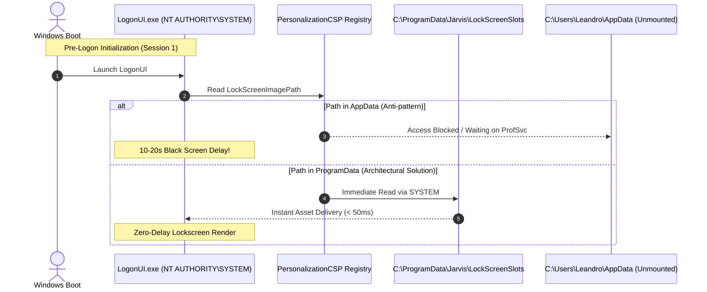

# Design Specification: Windows Lock Screen Fast Boot Architecture & Security Hardening

**Date:** 2026-10-07  
**Status:** Approved  
**Target:** `python-jarvis`

---

## 1. Overview & Goals

Synchronizing dynamic wallpapers with the Windows 10/11 Lock Screen requires interacting with the Windows Personalization Configuration Service Provider (`PersonalizationCSP`) registry hive:
`HKLM:\SOFTWARE\Microsoft\Windows\CurrentVersion\PersonalizationCSP`

Previous implementations suffered from two severe defects:
1. **The 10–20 Second Boot Black Screen:** When lock screen image slots were stored inside user profile directories (`%LOCALAPPDATA%` / `C:\Users\<User>\AppData\Local`), system cold boots exhibited an extended black screen delay.
2. **Over-Privileged Access Control Lists (ACLs):** Lock screen setup scripts previously granted `FullControl` to `BUILTIN\Users` (`S-1-5-32-545`), exposing registry keys to any local guest or secondary user.

This specification details the technical root cause and establishes the architecture for **zero-latency cold boots** alongside **least-privilege security hardening**.

---

## 2. Technical Root Cause & Architecture Analysis

### Why `%LOCALAPPDATA%` Causes Boot Delays
During Windows boot, `LogonUI.exe` executes under the `NT AUTHORITY\SYSTEM` service account in Session 1 **before any interactive user logs on**:
- The user profile service (`ProfSvc`) has not yet mounted `C:\Users\<User>\AppData`.
- The Windows `PersonalizationCSP` subsystem classifies user-profile paths as non-system assets and defers image ingestion until post-logon services initialize, resulting in a 10–20 second visual freeze/black screen.
- In contrast, `C:\ProgramData\Jarvis\LockScreenSlots` is immediately accessible to `SYSTEM` at boot stage 0 with zero disk latency.



---

## 3. Security & Permission Specifications

### 3.1 Strict User Scoping (NTAccount)
Access is restricted specifically to the interactive user rather than `BUILTIN\Users` (`S-1-5-32-545`):
```powershell
$rawUser = (Get-CimInstance Win32_ComputerSystem).UserName
if (-not $rawUser) {
    $identity = [System.Security.Principal.WindowsIdentity]::GetCurrent().User
} else {
    $identity = New-Object System.Security.Principal.NTAccount($rawUser)
}
```

### 3.2 Least-Privilege DACL Reduction
- **Registry Permissions:** Downgraded from `FullControl` to `SetValue, CreateSubKey, ReadKey`. The application requires write rights only for `LockScreenImagePath`, `LockScreenImageUrl`, and `LockScreenImageStatus`. Rights to alter permissions (`ChangePermissions`) or take ownership (`TakeOwnership`) are strictly denied.
- **Filesystem Permissions:** The cached slot directory `C:\ProgramData\Jarvis\LockScreenSlots` is granted `FileSystemRights.Modify`, allowing file creation and replacement while preventing permission mutations.

### 3.3 Non-Destructive Inheritance (`AddAccessRule`)
The permission setup script uses `AddAccessRule($rule)` instead of `SetAccessRule()`, ensuring existing parent inheritance from `CurrentVersion` is preserved without destabilizing Windows OS integrity.
