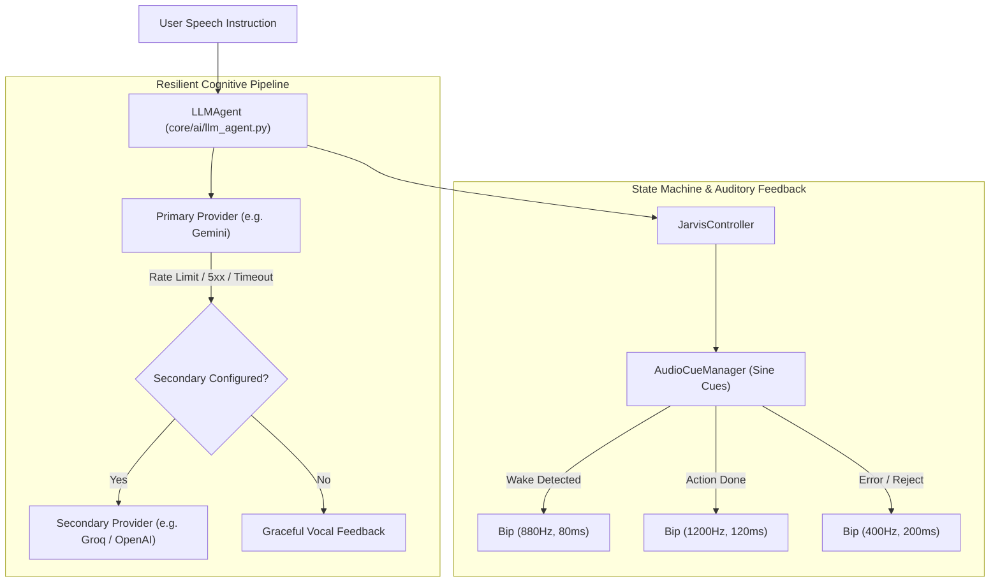

# Design Specification: Core Improvements, Multi-Provider Fallback & UI Synchronization

**Date:** 2026-10-11  
**Status:** Approved  
**Target:** `python-jarvis`

---

## 1. Overview & Goals

Following comprehensive production telemetry across v0.3.0 releases, this specification resolves several architectural and usability discrepancies across state management, provider synchronization, and feedback cues:
1. **Active LLM Provider Decoupling:** Modifying the active LLM provider in the GUI settings previously failed to update the live agent in memory without a full app restart.
2. **Command Palette History Clamping:** History queries were hardcoded to a limit of 5 items, failing to leverage the expanded palette UI.
3. **Auditory Cue Integration (`AudioCueManager`):** Earcon sound cues (distinct frequencies for wake detection, action confirmation, and errors) were defined but not consistently hooked into controller state transitions.
4. **Multi-Provider Cognitive Fallback:** Transient network blips or provider rate limits (e.g. Gemini 429 quota exhaustion) caused total command failure instead of transparently attempting a configured secondary provider.

---

## 2. Architecture & Execution Flow

---

## 3. Subsystem Specifications

### 3.1 Live Provider Re-initialization & Keyring Sync
- **Location:** `core/ui/tabs/settings_tab.py` & `core/ai/llm_agent.py`
- **Behavior:**
  - When the user selects a new LLM provider in `SettingsTab` and clicks *"Definir como Provedor Ativo"*:
    1. Validates presence of an API key in the Windows Credential Manager (`keyring`).
    2. Atomically updates `llm.active_provider` in `config.yaml` using regex surgical replacement (preserving comments).
    3. Invokes `llm_agent.reinit_provider()`, immediately switching runtime inference without restarting PyAudio or worker threads.

### 3.2 Dynamic Command Palette Telemetry
- **Location:** `core/ui/command_palette_qt.py` & `core/persistence/history_manager.py`
- **Behavior:**
  - `_fetch_commands()` queries `history_manager.get_recent_commands(limit=15)` when the palette expands.
  - Dedupes identical consecutive queries, rendering recent commands in a high-priority quick-access section.

### 3.3 Auditory Cues Binding
- **Location:** `core/audio/cues.py` & `core/controller.py`
- **Cue Frequencies:**
  - `CueType.WAKEWORD_DETECTED`: 880 Hz, 80ms duration.
  - `CueType.ACTION_COMPLETED`: 1200 Hz, 120ms duration.
  - `CueType.ACTION_ERROR`: 400 Hz, 200ms duration.
- **Thread Safety:** Executed asynchronously via `AudioCueManager.play_cue()` on an independent thread to prevent blocking the real-time audio capture loop.

### 3.4 Multi-Provider Fallback Cascade
- **Location:** `core/ai/llm_agent.py`
- **Behavior:**
  - Wraps `litellm.completion()` in an exponential retry and fallback block.
  - Detects `RateLimitError`, `APIConnectionError`, and HTTP 5xx errors.
  - Automatically queries the configured `fallback_provider` before raising a system error.
