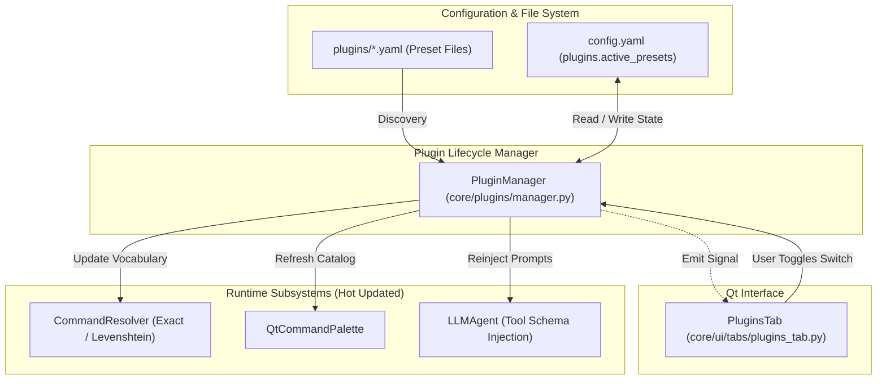

# Design Specification: Dynamic Plugin Presets & Hot-Reload Toggle Architecture

**Date:** 2026-10-13  
**Status:** Approved  
**Target:** `python-jarvis`

---

## 1. Overview & Goals

Originally, Jarvis loaded every automation file located in the `plugins/` folder indiscriminately at startup, with only a basic developer automation preset provided (`devtools.yaml`). Users had no interface or mechanism to disable categories they did not use, which cluttered the Command Palette and expanded the LLM system prompt with unnecessary tool definitions.

This specification introduces a complete **Plugin Preset & Hot-Reload Toggle Architecture**:
1. **Domain-Specific Automation Presets:** Standardizes built-in YAML presets covering core user workflows: Windows System (`system.yaml`), Web Browsing (`browser.yaml`), Productivity (`productivity.yaml`), Media/Entertainment (`media.yaml`), Gaming (`gaming.yaml`), and Software Development (`devtools.yaml`).
2. **Dedicated GUI Tab (`PluginsTab`):** A modern Qt management interface featuring categorized Fluent cards (`SimpleCardWidget`), command counts, and toggle switches (`SwitchButton`).
3. **Zero-Restart Live Reloading:** Enabling or disabling a plugin immediately recalculates active local regex/fuzzy match patterns, refreshes the Command Palette search index, and reconstructs the LLM tool prompt without terminating running background threads.
4. **State Persistence:** Preserves active preset preferences across restarts in `config.yaml`.

---

## 2. Architecture & Data Flow



---

## 3. Subsystem Specifications

### 3.1 Preset File Contract (`plugins/<preset>.yaml`)
Every preset YAML file adheres to the established DSL schema:
```yaml
name: "Sistema Windows"
category: "system"
description: "Comandos essenciais para gerenciamento e controle do sistema operacional."
enabled_by_default: true
commands:
  - id: "empty_recycle_bin"
    description: "Esvaziar lixeira"
    phrases: ["esvaziar lixeira", "limpar lixeira"]
    action: "powershell -Command Clear-RecycleBin -Force"
    risk_level: "low"
```

### 3.2 `PluginManager` Lifecycle & Hot-Reload
- **Module:** `core/plugins/manager.py`
- **Responsibilities:**
  - Scans `get_app_root() / "plugins"` for valid YAML files on boot.
  - Maintains `active_plugins: dict[str, Plugin]` and `disabled_plugins: dict[str, Plugin]`.
  - Exposes `toggle_plugin(plugin_id: str, enabled: bool) -> None`.
  - Atomically rebuilds execution indexes (`ExactMatch`, `FuzzyMatch`, and `LLM Prompt Schema`) and emits Qt signals to notify UI components.

### 3.3 GUI Implementation (`PluginsTab`)
- **Module:** `core/ui/tabs/plugins_tab.py`
- **Visual Design:**
  - Header toolbar with *"Abrir Pasta de Plugins"* (`TransparentToolButton` with folder icon).
  - List of categorized cards:
    - **Header:** Category icon, preset title, and active command badge (`5 comandos`).
    - **Body:** Brief description and expandable list showing command titles and trigger phrases.
    - **Control:** Fluent `SwitchButton` connected directly to `PluginManager.toggle_plugin`.

---

## 4. Configuration Schema (`config.yaml`)

```yaml
plugins:
  directory: "plugins"
  auto_reload: true
  active_presets:
    - "system"
    - "browser"
    - "productivity"
    - "media"
    - "devtools"
    - "gaming"
```
