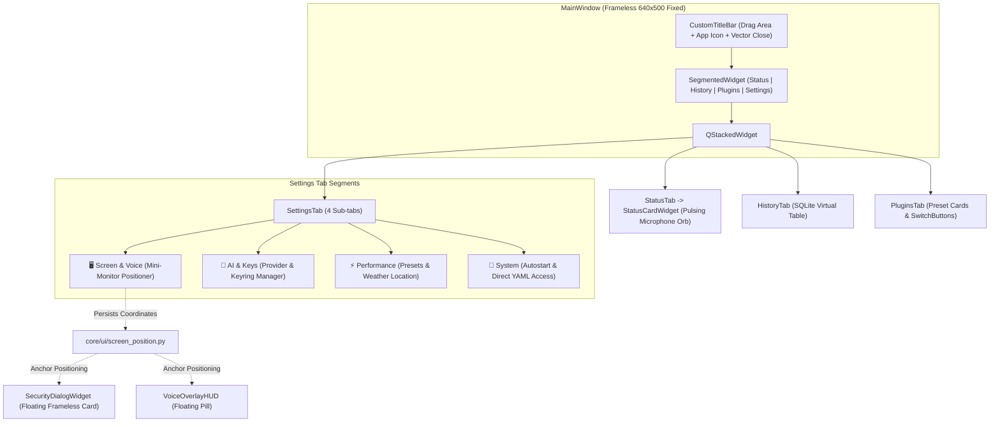

# Design Specification: Modern Frameless UI/UX Architecture & Widget Redesign

**Date:** 2026-10-29  
**Status:** Approved  
**Target:** `python-jarvis`

---

## 1. Overview & Goals

Earlier versions of the Jarvis UI utilized standard Windows native window decorations with resizable dimensions, causing visual whitespace imbalances, and a multi-tiered status screen displaying redundant State, Mode, and Status strings. Furthermore, risk confirmation prompts were displayed in traditional modal dialogs that abruptly stole keyboard focus from active terminal windows (Warp/PowerShell).

This specification establishes a modern, unified UI/UX architecture inspired by contemporary audio utility software (such as FxSound):

1. **Custom Frameless Window (`CustomTitleBar`):** Removes native OS chrome in favor of a sleek, draggable header with an official application icon, fine vector controls, and a fixed dimensions canvas (640x500 px) to prevent dead space.
2. **Centralized Status Dashboard (`StatusCardWidget`):** Replaces text-heavy widgets with a minimalist visual core centered around an animated pulsing blue **Microphone Orb**, real-time audio levels, and instant operational toggles (**Hybrid**, **Push-to-Talk**, and **Mute**).
3. **Non-Intrusive Floating Security Dialog (`SecurityDialogWidget`):** Implements an animated, rounded floating card that displays syntax-highlighted commands and visual countdowns without stealing active keyboard focus (`WA_ShowWithoutActivating`).
4. **Segmented Settings Architecture with Screen Positioning (`screen_position.py`):** Reorganizes settings into 4 tabbed subsections without page scrolling, featuring an interactive **Mini-Monitor Widget** to visually configure the on-screen placement of floating HUDs and dialogs.

---

## 2. Architecture & Component Hierarchy



---

## 3. Component Specifications

### 3.1 Custom Title Bar & Frameless Geometry
- **Window Flags:** `Qt.FramelessWindowHint | Qt.WindowSystemMenuHint | Qt.WindowMinimizeButtonHint`
- **Dimensions:** Locked to `640 x 500` pixels (`setFixedSize`), eliminating inconsistent scaling across multi-monitor setups.
- **Interactivity:** Custom mouse event handlers (`mousePressEvent`, `mouseMoveEvent`) map window drags smoothly while retaining standard Win32 snap behavior.

### 3.2 Status Card with Pulsing Microphone Orb
- **Module:** `core/ui/cards/status_card.py`
- **Visual Design:**
  - Dynamic SVG / QPainter microphone orb rendered with smooth antialiasing.
  - Multi-layer pulsating radial gradient in cyan/blue (`#00A3FF`) activated during `LISTENING` and `THINKING` states.
  - Linear audio amplitude indicator reacting to real-time RMS input.
  - State label, active wake word indicator, and 3 segmented quick-action buttons:
    - `Hybrid`: Wake word + Push-to-Talk active.
    - `Push-to-Talk`: Hardware hotkey only.
    - `Mute`: Audio engine paused.

### 3.3 Non-Intrusive Floating Security Dialog
- **Module:** `core/ui/dialogs/security_dialog.py`
- **Focus Preservation:** Configured with `Qt.WA_ShowWithoutActivating` and `Qt.WindowStaysOnTopHint`. Prevents interrupting developer typing flows in terminals or code editors.
- **Visual Feedback:**
  - Rounded floating card (`border-radius: 12px`, dark acrylic background).
  - Code block displaying exact target executable and parameters.
  - Visual countdown progress bar with auto-reject on expiration.
  - Slide-in and fade-out animation curves using `QPropertyAnimation`.

### 3.4 Screen Positioning Engine & Mini-Monitor Widget
- **Module:** `core/ui/screen_position.py`
- **Supported Anchors:**
  - `top_left`, `top_center`, `top_right`
  - `center`
  - `bottom_left`, `bottom_center` (default for voice HUD), `bottom_right` (default for security alerts)
- **Calculation Logic:** Dynamically queries `QScreen.availableGeometry()` to avoid overlapping the Windows Taskbar regardless of whether it is positioned at the bottom, top, or sides.
- **Mini-Monitor Selector:** Interactive Qt widget presenting a visual representation of a desktop monitor with a 3x3 clickable grid that previews the selected screen anchor in real time.

---

## 4. Configuration Schema (`config.yaml`)

```yaml
ui:
  theme: "dark"
  window:
    frameless: true
    width: 640
    height: 500
  security_dialog:
    position: "bottom_right" # Options: top_left, top_center, top_right, center, bottom_left, bottom_center, bottom_right
    auto_dismiss_seconds: 10
  voice_hud:
    position: "bottom_center"
    enabled: true
```
