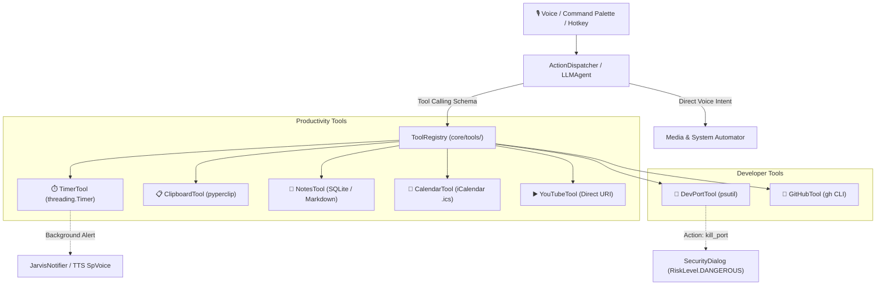

# Design Specification: Scoped Productivity & Developer Integrations Suite

**Date:** 2026-11-01  
**Status:** Approved  
**Target:** `python-jarvis`

---

## 1. Overview & Goals

As Jarvis evolved from a voice terminal assistant into an integrated daily desktop companion, user demands shifted toward unified management of background timers, scratchpad notes, local developer port governance, and system productivity. Prior to this design, users had to switch contexts to external applications for simple alarms, clipboard inspections, or killing lingering local dev servers.

This specification introduces a modular suite of **7 Scoped Productivity & Developer Tools** natively integrated into Jarvis's `ToolRegistry` and `ActionDispatcher`:

1. **Timer & Pomodoro Tool (`TimerTool`):** In-memory asynchronous countdowns, recurring focus intervals (Pomodoro), and background Windows toast notifications.
2. **Clipboard Management Tool (`ClipboardTool`):** Safe retrieval and mutation of the OS clipboard buffer with privacy guardrails.
3. **Notes & Scratchpad Tool (`NotesTool`):** Fast local note-taking backed by SQLite, with Markdown export capability compatible with Obsidian vaults.
4. **Local Port & Process Governance (`DevPortTool`):** Inspection of active TCP/UDP ports via `psutil` and guarded termination of rogue developer processes (`kill_port`).
5. **GitHub Workspace Tool (`GitHubTool`):** Frictionless repository telemetry (PRs, issues, CI workflow status) delegating to the authenticated `gh` CLI.
6. **Local Calendar Tool (`CalendarTool`):** Zero-cloud, privacy-preserving agenda inspection parsing standard `.ics` (iCalendar) feeds.
7. **Media & Streaming Tool (`YouTubeTool`):** Voice-activated search and direct browser playback for video and audio content.

### Architectural Constraints:
- **Zero New Dependencies:** Strictly utilizes Python standard library (`sqlite3`, `threading`, `urllib`, `subprocess`) alongside existing workspace dependencies (`psutil`, `plyer`, `pyperclip`).
- **Security Governance:** Granular risk levels (`RiskLevel.SAFE` for read-only queries; `RiskLevel.DANGEROUS` for process termination), enforced via `SecurityDialogWidget` before destructive actions.
- **Portability:** Path resolution rooted in `core.shared.paths.get_app_root()` for compatibility with PyInstaller frozen binaries.

---

## 2. Architecture & Data Flow



---

## 3. Tool Specifications & Contracts

### 3.1 TimerTool (`core/tools/timer_tool.py`)
- **Class:** `TimerTool(BaseTool)`
- **Tool Name:** `"timer"`
- **Risk Level:** `RiskLevel.SAFE`
- **Actions:**
  - `start`: Registers an active countdown with `duration_seconds` (or minutes) and custom `label`.
  - `pomodoro`: Triggers a standard 25-minute focus session (with configurable short/long break presets).
  - `list`: Returns active timers with remaining time formatting.
  - `cancel`: Terminates an active timer by `timer_id` or `label`.
- **Background Execution:** Spawns asynchronous daemon threads. Upon expiration, invokes `JarvisNotifier.show_toast()` and triggers optional vocal feedback with thread-safe `pythoncom.CoInitialize()`.

### 3.2 ClipboardTool (`core/tools/clipboard_tool.py`)
- **Class:** `ClipboardTool(BaseTool)`
- **Tool Name:** `"clipboard"`
- **Risk Level:** `RiskLevel.SAFE`
- **Actions:**
  - `read`: Returns current clipboard text trimmed to a safe maximum length (1000 characters).
  - `write` / `copy`: Replaces clipboard contents with provided text.
  - `clear`: Purges clipboard memory to avoid accidental credential leaks.

### 3.3 NotesTool (`core/tools/notes_tool.py`)
- **Class:** `NotesTool(BaseTool)`
- **Tool Name:** `"notes"`
- **Risk Level:** `RiskLevel.SAFE`
- **Storage:** Persisted in `%APPDATA%/Jarvis/notes.db` (SQLite with WAL mode).
- **Actions:** `add_note`, `list_notes`, `search_notes`, `delete_note`.
- **Obsidian / Vault Integration:** When configured in `config.yaml`, writes daily logs or notes directly into a designated local directory as clean GitHub Flavored Markdown.

### 3.4 DevPortTool (`core/tools/dev_port_tool.py`)
- **Class:** `DevPortTool(BaseTool)`
- **Tool Name:** `"dev_port"`
- **Risk Level:** `RiskLevel.SAFE` for inspection; elevated to `RiskLevel.DANGEROUS` when `action == "kill_port"`.
- **System Safety Guardrails:**
  - Automatically denies killing core Windows system processes (`pid <= 4` or system binaries like `svchost.exe`, `csrss.exe`, `explorer.exe`).
  - Requires user approval via floating `SecurityDialogWidget` before executing process termination.

### 3.5 GitHubTool (`core/tools/github_tool.py`)
- **Class:** `GitHubTool(BaseTool)`
- **Tool Name:** `"github"`
- **Risk Level:** `RiskLevel.SAFE`
- **Mechanism:** Executes non-interactive commands via `gh` CLI (`gh pr list`, `gh issue list`, `gh run list`) with 5-second timeout and JSON parsing.

### 3.6 CalendarTool (`core/tools/calendar_tool.py`)
- **Class:** `CalendarTool(BaseTool)`
- **Tool Name:** `"calendar"`
- **Risk Level:** `RiskLevel.SAFE`
- **Format:** Parses standard `.ics` files configured in `config.yaml` (`tools.calendar.ics_path`). Evaluates recurrence rules and returns upcoming agenda events for today and tomorrow.

### 3.7 YouTubeTool (`core/tools/youtube_tool.py`)
- **Class:** `YouTubeTool(BaseTool)`
- **Tool Name:** `"youtube"`
- **Risk Level:** `RiskLevel.SAFE`
- **Behavior:** Resolves query into URL-encoded search or direct video launch (`https://www.youtube.com/results?search_query=...`) using the default browser via `webbrowser.open_new_tab()`.

---

## 4. Configuration Schema Updates (`config.yaml`)

```yaml
tools:
  timer:
    enabled: true
    sound_alert: true
    default_pomodoro_minutes: 25
  clipboard:
    enabled: true
    max_history_chars: 1000
  notes:
    enabled: true
    obsidian_sync_path: "" # Optional path to Obsidian vault
  dev_port:
    enabled: true
    protected_ports: [80, 443, 135, 445]
  github:
    enabled: true
    default_repo: "" # Optional owner/repo fallback
  calendar:
    enabled: false
    ics_path: "" # Local path to exported iCalendar file
  youtube:
    enabled: true
```
