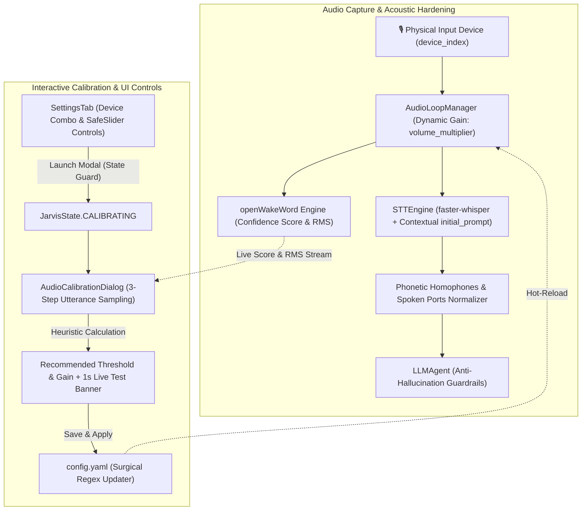

# Design Specification: Interactive Audio Calibration & Speech Hardening

**Date:** 2026-11-03  
**Status:** Implemented (v0.8.0)  
**Target:** `python-jarvis`

---

## 1. Overview & Problem Statement

Prior to version 0.8.0, Jarvis relied on a static wake word sensitivity threshold (`0.50`), a fixed PCM volume multiplier (`1.0x`), and the default Windows OS audio input device. In practice, Windows desktop environments exhibit immense acoustic diversity:
1. **Microphone Heterogeneity & Gain Imbalance:** Users with desktop condenser microphones often speak from 40–60 cm away, producing low RMS values and wake word scores around `0.35–0.45` (resulting in missed activations and false negatives). Conversely, headset microphones with hardware preamps frequently trigger false activations on background speech or breathing noises.
2. **Device Enumeration & Encoding Quirks:** PyAudio / PortAudio on Windows returns virtual capture devices (e.g., "Microsoft Sound Mapper", "Stereo Mix") and raw system strings encoded in CP1252/Windows-1252, resulting in mojibake (e.g., `"Driver de captura de som prim\xc3\xa1rio"`) and device index confusion.
3. **UI Interaction Flaws:** Standard `qfluentwidgets.Slider` components modified values immediately upon mouse hover without requiring a click or drag, and intercepted mouse scroll wheel events during page scrolling. Additionally, long un-wrapped description labels forced card layouts beyond the scroll area viewport, causing right-margin clipping.
4. **Speech-to-Text Phonetic Fragility:** Spoken commands containing technical terms or Brazilian Portuguese phonetic adaptations (e.g., *"taimer"*, *"clipe borde"*, *"pê-érre"*, *"porta três mil"*) frequently resulted in Whisper hallucinations or transcription divergence.

This specification documents the architecture and implementation of the **Interactive Audio Calibration Wizard**, **Input Device Selection Engine**, **Safe Slider Control System**, and **Acoustic Hardening Pipeline** delivered in Jarvis v0.8.0.

---

## 2. Architecture & Data Flow

---

## 3. Core Component Specifications & Contracts

### 3.1 Audio Loop & Dynamic Gain (`core/audio/audio_loop.py`)
- **Gain Processing:** Reads `volume_multiplier` dynamically from `config.yaml` or runtime setter. In `AudioLoopManager._read_audio_stream()`, incoming raw 16-bit PCM samples are scaled:
  `PCM_scaled = np.clip(PCM_raw * gain, -32768, 32767)`
- **Dynamic Setter:** `set_volume_multiplier(gain: float) -> None` provides hot-reloading without stream re-initialization.

### 3.2 Input Device Discovery & Stream Initialization (`core/audio/audio_engine.py`)
- **Device Filter (`get_input_devices()`):**
  - Iterates over PyAudio host API input devices.
  - Repairs mojibake using multi-pass decoding: `name.encode("latin-1").decode("utf-8")`.
  - Filters out virtual routing drivers (e.g., *"Mapeador de som"*, *"Driver de captura primário"*, *"Mixagem estéreo"*).
  - Deduplicates hardware endpoints and returns clean tuples: `list[tuple[int, str]]`.
- **Stream Fallback Resilience (`get_audio_stream()`):**
  - Accepts optional `device_index: int | None`.
  - If opening a specified `device_index` raises an `IOError` / `PyAudioError`, logs a warning, resets `device_index` to `None`, and falls back immediately to the OS default input device to prevent startup crashes.

### 3.3 Safe Slider Control (`core/ui/widgets/safe_slider.py`)
- **Class:** `SafeSlider(Slider)`
- **Motivation:** Default `qfluentwidgets.Slider` updates value on mouse move events without checking if the left button is pressed, leading to accidental adjustments during mouse movement. Furthermore, page scrolling over sliders inadvertently adjusted values.
- **Contract:**
  - `mouseMoveEvent(e)`: Ignores events unless `e.buttons() & Qt.MouseButton.LeftButton` is explicitly active.
  - `wheelEvent(e)`: Explicitly calls `e.ignore()` to let the parent scroll area handle scrolling without modifying slider position.

### 3.4 Interactive Calibration Wizard (`core/ui/widgets/audio_calibration_dialog.py`)
- **Class:** `AudioCalibrationDialog(QDialog)`
- **State Machine:**
  - `Step 0`: Introduction & instructions.
  - `Steps 1–3`: Live acoustic sampling iterations. Tracks utterance peak score and RMS across a 600ms cooldown window.
  - `Step 4`: Review & Live Testing. Displays read-only recommended values and an interactive banner.
- **Recommendation Heuristics (`calculate_recommendations(samples)`):**
  - `Threshold = clamp(round(min(scores) * 0.82, 2), 0.25, 0.80)`
  - `Volume Multiplier`: If average RMS < 25.0, recommends `1.2x` to `1.5x` boost; otherwise standard `1.0x`.
  - `Speech RMS = clamp(round(avg_rms * 0.45, 1), 12.0, 35.0)`.
- **Live Verification Banner:**
  - In Step 4, when the user speaks "Hey Jarvis", triggers immediate visual feedback:
  - Updates banner to `🎯 "Hey Jarvis" detectado com sucesso!` with vibrant green background (`#0e5a28`).
  - Sets a 1-second single-shot `QTimer` to revert the banner to `🎤 Fale 'Hey Jarvis' agora para testar...`.
- **State Restoration:**
  - Records `self._previous_state` on `showEvent()`. Transitions to `JarvisState.CALIBRATING`.
  - Upon modal close or rejection, safely restores `JarvisState.MUTED` if it was muted prior to opening, or `JarvisState.IDLE` otherwise.

### 3.5 Settings Tab Hardening & Responsiveness (`core/ui/tabs/settings_tab.py`)
- **Card 2.5 (Dispositivo & Calibração de Áudio):**
  - Input device dropdown (`input_device_combo`) populated with discovered physical microphones.
  - Informative label alerting that device switching requires restarting Jarvis.
  - Two `SafeSlider` controls for manual fine-tuning:
    - *Sensibilidade Wake Word* (0.10 to 0.90, step 0.05).
    - *Ganho do Microfone* (0.5x to 3.0x, step 0.1x).
  - Compact primary action button: `🎙️ Calibrar Microfone...`.
- **Layout & Overflow Elimination:**
  - Fixed-width labels set to `165px` to prevent truncation of Portuguese text (e.g., *"Sensibilidade Wake Word:"*).
  - Explicit `mic_desc.setWordWrap(True)` to prevent the description label from expanding the card's minimum horizontal size hint beyond the viewport.
  - Margins set to `layout.setContentsMargins(0, 2, 8, 8)` to leave adequate clearance for the 14px Fluent scrollbar track.
  - State guard preventing dialog launch while Jarvis is busy (`LISTENING`, `THINKING`, `EXECUTING`, `CONFIRMING_DRY_RUN`).

### 3.6 Speech Robustness & Acoustic Hardening (`core/audio/stt_engine.py` & `core/shared/utils.py`)
- **Contextual Whisper Biasing (`build_contextual_prompt`):**
  - Injects capped `initial_prompt` containing ecosystem keywords (`Jarvis`, `timer`, `pomodoro`, `YouTube`, `GitHub`, `pull request`, `PR`, `clipboard`, `Obsidian`, `Spotify`, `porta`, `localhost`, `Docker`, `Python`, `VS Code`, `commit`, `status`).
  - Capped to 250 characters with strict boundary checks to avoid prompt overflow.
- **Phonetic Homophone Normalization (`core/shared/utils.py`):**
  - Regex replacement for spoken jargon:
    - Productivity: `taimer` / `taymer` -> `timer`; `clipe borde` / `clipbord` -> `clipboard`; `obsidiam` -> `Obsidian`.
    - Developer tooling: `guite` -> `git`; `guithabi` -> `GitHub`; `pê-érre` -> `pull request`; `dóquer` -> `docker`.
  - Spoken network ports: `porta três mil` -> `porta 3000`; `porta quatro mil` -> `porta 4000`; `porta oito mil e oitenta` -> `porta 8080`.
- **LLM Anti-Hallucination Guardrails (`core/ai/llm_agent.py`):**
  - System prompt directives instructing the model to tolerate minor STT noise and phonetics without commenting on pronunciation, but explicitly return conversational chat requests for clarification when audio noise is unintelligible, preventing rogue command execution.

### 3.7 Non-Destructive YAML Configuration Updates (`core/infra/config.py`)
- **Surgical Updaters:**
  - `update_yaml_float_setting(section, key, value, subsection=None, precision=2)`
  - `update_yaml_device_index(device_index)`
- **Mechanism:** Uses regex-based line replacements rather than standard `yaml.safe_dump()`, ensuring all user comments, indentation, and structure in `config.yaml` remain intact.

---

## 4. Safety & Security Guardrails

| Guardrail | Mechanism | Purpose |
| :--- | :--- | :--- |
| **State Isolation** | `JarvisState.CALIBRATING` | Prevents TTS utterances or command execution while sampling calibration phrases. |
| **State Guard on Launch** | `_open_audio_calibration_dialog` | Blocks modal launch if Jarvis is active in speech recognition, thinking, or action execution. |
| **Safe Restoration** | `_ensure_idle_state` | Restores previous state (`MUTED` if previously muted; `IDLE` otherwise). |
| **Heuristic Clamping** | Safety bounds in `calculate_recommendations` | Restricts threshold to `[0.25, 0.80]` and gain to `[0.5x, 3.0x]`, preventing inoperable configurations. |
| **Device Fallback** | Fallback in `get_audio_stream` | Reverts to default system input if a selected `device_index` fails to open. |
| **Template Neutrality** | Repository `config.yaml` policy | Commits clean default values (`1.0x`, `0.50`, `20.0`, `device_index: null`) to prevent hardware bias on clone. |

---

## 5. Verification & Testing

The implementation is verified by 54 automated unit tests:

1. **`tests/unit/test_audio_calibration.py` (16 tests):**
   - Validates recommendation heuristics across diverse sample profiles (healthy voice, quiet microphone, safety floors/ceilings).
   - Validates PyAudio input device enumeration, filtering of virtual sound cards, and encoding repair.
   - Tests `get_audio_stream` fallback behavior when invalid device indices are provided.
   - Tests surgical YAML float and device index updating preserving file formatting.
   - Tests `SafeSlider` rejection of mouse hover and wheel events using Qt6 `QMouseEvent` and `QWheelEvent`.
2. **`tests/unit/test_speech_robustness.py` (38 tests):**
   - Validates Whisper `initial_prompt` construction, uniqueness deduplication, and character length capping.
   - Validates phonetic homophone normalization for productivity tools, developer tools, and network ports.
   - Validates LLM system prompt hardening against hallucinations.
