# Design Specification: Updater UX, Calibration Noise Resilience & Media Routing Hardening

**Date:** 2026-11-06  
**Status:** Implemented (v0.8.1)  
**Target:** `python-jarvis`

---

## 1. Overview & Problem Statement

Following the v0.8.0 release, real-world usage exposed five edge cases across the auto-updater, audio calibration wizard, media intent router, and fullscreen detector:
1. **Missed Boot Update Checks & Hidden Update Button:** `UpdatePreferenceManager.can_check_on_boot()` used a single 24-hour timer to throttle the network request itself rather than the tray notification balloon, and recorded `last_check_timestamp` even when offline or before a release was published that day. Furthermore, when an update was detected on boot, `SettingsTab` was not populated with the `ReleaseInfo` object, leaving the update button hidden until the user clicked "Verificar Atualizações" manually.
2. **Tray Notification Click Disorientation:** Clicking the Windows system tray update notification balloon opened `MainWindow` on the default tab without navigating to `Configurações -> 🔄 Sistema` (`"sys_upd"`), and if the user clicked the balloon after a transient network glitch, no visual feedback explained where to check for updates.
3. **Calibration Utterance Hang & 0.8x Gain Reduction in 16-bit PCM:** In `AudioCalibrationDialog`, utterance completion required `rms < 12.0`, causing steps to hang in rooms with normal ambient noise (`20–80` RMS). Additionally, `calculate_recommendations()` reduced microphone gain to `0.8x` whenever `mean_rms > 120.0`, which is nearly silent in 16-bit signed PCM (`[-32768, 32767]`), inadvertently attenuating normal microphones.
4. **Spotify vs. YouTube Tool Misrouting:** Because `YouTubeTool` was registered in `ToolRegistry`, the LLM occasionally routed *"coloca uma música no Spotify"* to `tool_call: youtube` instead of `type: media` (`Spotify`), and cached that misrouted response in `llm_cache`.
5. **False-Positive Fullscreen Suspension in IDEs:** Borderless or maximized developer tools (`antigravity`, `cursor`, `windsurf`, `windowsterminal`, `obsidian`, `discord`, `spotify`) triggered `is_fullscreen()`, suspending voice activation during coding sessions.

This specification documents the architectural fixes delivered in Jarvis v0.8.1.

---

## 2. Architecture & Data Flow

```mermaid
flowchart TD
    subgraph BootUpdater ["Decoupled Auto-Updater Lifecycle"]
        Boot["App Startup (QtAppController)"] --> NetCheck{"can_check_on_boot()<br/>(check_interval_hours = 2h)"}
        NetCheck -->|"Allowed"| GitHubAPI["UpdateManager.check_for_updates()"]
        GitHubAPI -->|"ReleaseInfo"| FeedUI["settings_tab.show_update_available(info)"]
        GitHubAPI -->|"Success"| RecordCheck["record_check()"]
        FeedUI --> Cooldown{"should_notify_version(v)<br/>(cooldown = 24h)"}
        Cooldown -->|"Yes"| TrayBalloon["Tray Balloon Notification + record_notified_version(v)"]
        TrayBalloon -->|"User Clicks Balloon"| FocusSysTab["Open SettingsTab -> 'sys_upd' + Pulse Highlight"]
    end

    subgraph MediaGuard ["Deterministic Media vs. YouTube Guardrail"]
        Input["User Command"] --> CacheOrLLM["SQLite Cache / LiteLLM"]
        CacheOrLLM --> Guard{"_normalize_media_vs_youtube_routing()"}
        Guard -->|"Mentions Spotify / Music without YouTube"| MediaRoute["Rewrite to type='media' (PLAY_QUERY) & Update Cache"]
        Guard -->|"Explicit YouTube Intent"| ToolRoute["Keep tool_call='youtube'"]
    end
```

---

## 3. Core Component Specifications & Contracts

### 3.1 Decoupled Update Check & Notification Cooldown (`core/infra/update_preferences.py`)
- **State Schema (`updates_state.json`):**
  - `last_check_timestamp`: Updated exclusively after a completed network check (`record_check()`).
  - `last_notified_version` & `last_notified_timestamp`: Tracks when a specific release tag was last shown in a tray balloon.
- **Contracts:**
  - `can_check_on_boot(check_interval_hours: float = 2.0) -> bool`: Allows lightweight background checks every 2 hours on boot.
  - `should_notify_version(version: str, notification_cooldown_hours: float = 24.0) -> bool`: Immediately notifies whenever a newer version is released (`last_notified_version != version`), while throttling repeated reminders for the same version to once per 24 hours.

### 3.2 Update Notification Navigation & Visual Pulse (`core/ui/app_controller.py` & `core/ui/tabs/settings_tab.py`)
- **Boot Synchronization:** When `_on_update_available(release_info)` fires in `QtAppController`, it immediately invokes `self.main_window.settings_tab.show_update_available(release_info)` so the update banner and install button are ready before the user opens the window.
- **Direct Sub-Tab Navigation (`_on_tray_message_clicked`):** Opens `MainWindow`, switches the main navigation to `"settings"`, selects the `"sys_upd"` sub-tab (`🔄 Sistema`), and triggers `highlight_update_section()` (a 6-step `#4cc2ff` border pulse animation on `update_card` and `check_update_btn`).

### 3.3 Calibration Noise Resilience & 16-bit PCM Gain (`core/ui/widgets/audio_calibration_dialog.py`)
- **Relative RMS Drop Utterance End:** Marks an active calibration utterance as finished when `score < 0.15` and either `rms < 12.0` OR (`peak_score >= 0.30` and `rms < peak_rms * 0.35`), allowing reliable step progression in environments with `20–80` RMS background noise.
- **16-bit PCM Gain Ceiling:** Only recommends attenuating gain to `0.8x` when `mean_rms > 6000.0` and `min_score >= 0.85`, preserving `1.0x+` gain for standard desktop microphones.
- **Extended Live Test Feedback:** Extends Step 4 detection banner timer from `1000ms` to `2500ms` for comfortable visual confirmation.

### 3.4 Spotify vs. YouTube Routing Guardrail (`core/ai/llm_agent.py`)
- **`_normalize_media_vs_youtube_routing(text, decision)`:**
  - Applied to both live LLM JSON responses and `llm_cache` hits.
  - If `decision` is `{"type": "tool_call", "tool_name": "youtube"}` and the user command explicitly mentions `"spotify"` (or requests music playback without mentioning `"youtube"` / `"vídeo"`), rewrites the payload into a `{"type": "media", "action": "PLAY_QUERY", "target_app": "spotify", ...}` decision and updates `llm_cache`.

### 3.5 Fullscreen Non-Game Process Filter (`core/activation.py`)
- Adds `antigravity`, `cursor`, `windsurf`, `windowsterminal`, `discord`, `spotify`, `obsidian`, `slack`, `notion`, `snippingtool`, and `screenclippinghost` to `non_game_procs` in `ActivationManager.is_fullscreen()`, preventing false-positive `SUSPENDED` transitions during development workflows.

---

## 4. Verification & Testing

Verified by unit and integration test suites:
1. **`tests/unit/test_update_preferences.py`:** Validates 2-hour network check interval vs. 24-hour per-version notification cooldown and immediate notification on newer tags.
2. **`tests/unit/test_app_controller_integration.py`:** Validates boot update propagation to `SettingsTab` and tray balloon click navigation to `"sys_upd"`.
3. **`tests/unit/test_audio_calibration.py`:** Validates relative RMS drop utterance progression under ambient noise and 16-bit PCM gain thresholds.
4. **`tests/unit/test_llm_agent.py`:** Validates `_normalize_media_vs_youtube_routing` for live and cached responses.
