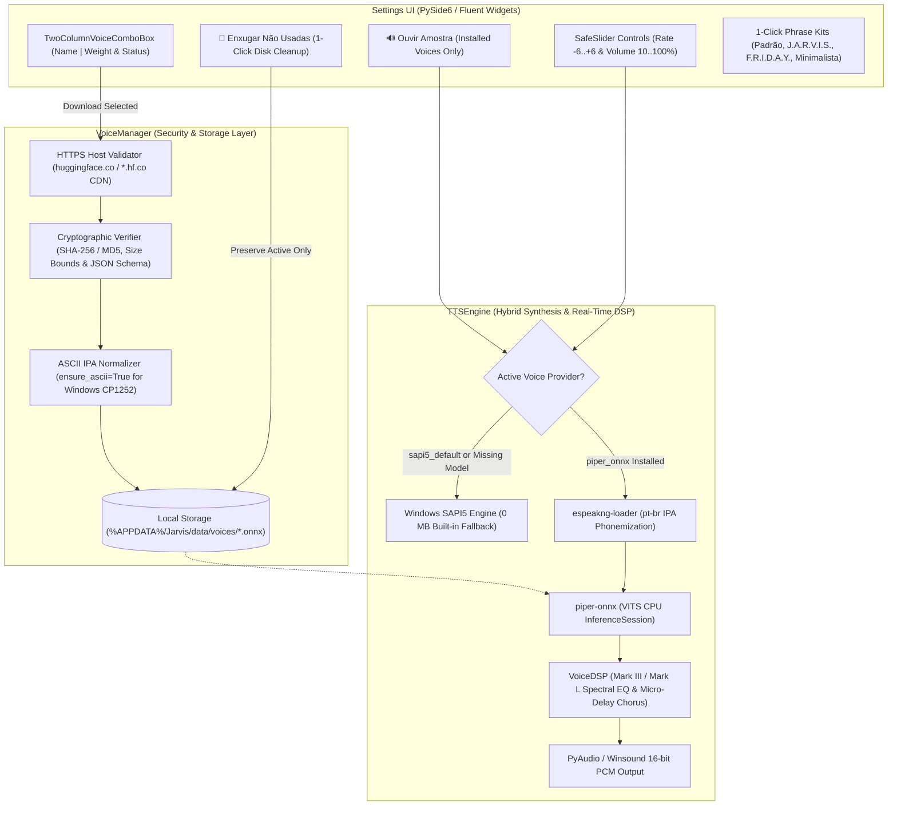

# Design Specification: Downloadable Neural Voice Packs, Holographic DSP & Multi-Stage Phrases

**Date:** 2026-11-12  
**Status:** Implemented (v0.9.0)  
**Target:** `python-jarvis`

---

## 1. Overview & Problem Statement

Prior to version 0.9.0, Jarvis relied exclusively on the Windows SAPI5 speech synthesizer (`voice_keyword: "maria"`) and only allowed customizing a single spoken string (`response_phrase: "Sim?"` upon wake word activation). While functional and zero-footprint, this created three user experience limitations:
1. **Limited Voice Variety & Persona Immersion:** Users could not choose between male and female neural voices or iconic assistant personas such as **J.A.R.V.I.S. (Mark III)** and **F.R.I.D.A.Y. (Mark L)** without manually installing third-party SAPI5 registries on Windows.
2. **Bundle Size vs. Security Trade-Off:** Bundling multiple neural `.onnx` TTS models directly inside the installer would add ~360–480 MB to `Jarvis-windows-x64.zip`. Conversely, downloading voice models on demand requires strict security controls against arbitrary URL execution, man-in-the-middle tampering, path traversal, and Windows `CP1252` locale encoding crashes when loading IPA phoneme maps.
3. **Hardcoded Lifecycle Feedback Phrases:** Completion (`"Pronto!"`), empty-audio (`"Desculpe, não ouvi nada."`), and unintelligible-command (`"Desculpe, não entendi."`) phrases were hardcoded across `dispatcher.py` and `worker.py`, preventing users from tailoring the assistant's tone across its full operational lifecycle.

This specification documents the architecture and implementation of the **Curated Neural Voice Catalog**, **Security-First Voice Manager**, **Real-Time Holographic DSP Engine**, **Two-Column Voice Selector Widget**, and **Multi-Stage Lifecycle Phrase System** delivered in Jarvis v0.9.0.

---

## 2. Architecture & Data Flow

---

## 3. Core Component Specifications & Contracts

### 3.1 Curated Voice Catalog & Phrase Presets (`core/audio/voice_catalog.py`)
- **Catalog Size & Balance (`VOICE_CATALOG`):** Provides 9 curated options (4 female, 5 male — strictly bounded below the 12-option UX ceiling):
  1. `sapi5_default`: *Windows Nativo — Maria (Fem.)* (`0 MB`, built-in default)
  2. `jarvis_mk3`: *J.A.R.V.I.S. — Mark III (Masc.)* (`jarvis_mk3.onnx` + `jarvis_mk3` DSP profile)
  3. `friday_mk50`: *F.R.I.D.A.Y. — Mark L (Fem.)* (`friday_mk50.onnx` + `friday_mk50` DSP profile)
  4. `piper_dii`: *Dii — Estúdio Neural (Fem.)* (`dii_pt-BR.onnx`)
  5. `piper_sage`: *Sage — Serena Neural (Fem.)* (`pt_BR-sage_13364-medium.onnx`)
  6. `piper_faber`: *Faber — Estúdio Neural (Masc.)* (`pt_BR-faber-medium.onnx`)
  7. `piper_cadu`: *Cadu — Firme Neural (Masc.)* (`pt_BR-cadu-medium.onnx`)
  8. `piper_jeff`: *Jeff — Jovem Neural (Masc.)* (`pt_BR-jeff-medium.onnx`)
  9. `piper_edresson`: *Edresson — Compacta (Masc.)* (`pt_BR-edresson-low.onnx`)
- **Independent Asset Isolation (`MODEL_ASSETS`):** Each neural preset maps 1-to-1 to its own `VoiceModelAsset` and local filename so installing or cleaning up one persona (e.g., `jarvis_mk3`) never falsely marks another preset (e.g., `piper_faber`) as installed.
- **Stage Phrase Kits (`STAGE_PHRASE_PRESETS`):** Defines 4 lifecycle stage keys (`response_phrase`, `completion_phrase`, `no_speech_phrase`, `not_understood_phrase`) across 4 thematic presets (`Padrão`, `J.A.R.V.I.S.`, `F.R.I.D.A.Y.`, `Minimalista`).

### 3.2 Security-First Voice Manager (`core/audio/voice_manager.py`)
- **HTTPS & CDN Allowlist (`validate_download_url`):**
  - Enforces `https://` scheme exclusively.
  - Validates both the initial request URL and post-redirect `resp.geturl()` against `ALLOWED_VOICE_DOMAINS = ("huggingface.co", "hf.co")` and their official subdomains (e.g., `us.aws.cdn.hf.co`, `cdn-lfs.huggingface.co`).
- **Atomic Download & Cryptographic Verification (`download_voice_model`):**
  - Streams remote payloads in 64 KB chunks to `.part` temporary files while enforcing hard byte ceilings (`MAX_ONNX_BYTES = 80 MB`, `MAX_JSON_BYTES = 64 KB`).
  - Verifies exact byte size and cryptographic `SHA-256` / `MD5` digests via `verify_onnx_file` and `verify_json_file` before atomic `os.replace()` installation.
  - Re-serializes verified `.onnx.json` configs with `json.dumps(parsed, ensure_ascii=True, indent=2)` so `piper_onnx` (which opens config files without `encoding="utf-8"`) never fails with `UnicodeDecodeError` (`0x90`) or IPA mojibake under Windows `CP1252`.
- **Unused Voice Cleanup (`cleanup_unused_voices`):**
  - Deletes all downloaded `.onnx`, `.onnx.json`, and leftover `.part` files in `voices_dir` except the asset belonging to `active_voice_id`, returning `(removed_count, freed_bytes)`. Never affects the built-in Windows SAPI5 voice.
- **Friendly Error Translation (`format_user_error`):**
  - Translates low-level network, HTTP, disk, and security exceptions into concise Brazilian Portuguese user messages while logging technical details to `logger.error`.

### 3.3 Real-Time Acoustic DSP Filters (`core/audio/voice_dsp.py`)
- **Pure NumPy Spectral & Time-Domain Processing:**
  - `apply_jarvis_mk3_dsp(samples, sample_rate)`: Applies 115 Hz high-pass filtering, 2.75 kHz narrow-band helmet resonance boost, 9.2 ms micro-delay metallic chorus (`mix=0.20`), and soft `tanh` harmonic saturation with peak normalization.
  - `apply_friday_mk50_dsp(samples, sample_rate)`: Applies 135 Hz high-pass filtering, 3.25 kHz crystalline presence boost, 6.5 ms spatial micro-delay (`mix=0.14`), and gentle soft-clipping.

### 3.4 Hybrid TTS Engine (`core/audio/tts_engine.py`)
- **Explicit Portuguese Phonemization:** Configures `EspeakWrapper` with `espeakng_loader` library/data paths and invokes `phonemize(..., language="pt-br", backend="espeak", preserve_punctuation=True, with_stress=True)` before passing `is_phonemes=True` to `Piper.create()`, preventing `piper_onnx` from defaulting to English (`en-us`) phonemization.
- **Rate & Volume Mapping:** Maps UI speech rate (`-6` to `+6`) to VITS `length_scale` (`rate_to_length_scale`) and scales 16-bit PCM amplitude by `volume / 100.0`.
- **Seamless Fallback:** Automatically falls back to Windows SAPI5 if a configured neural model is missing or evicted.

### 3.5 Two-Column Voice Selector & Overflow Protection (`core/ui/widgets/voice_combo_box.py`)
- **Class:** `TwoColumnVoiceComboBox(ComboBox)` & `TwoColumnVoiceMenuItemDelegate(IndicatorMenuItemDelegate)`
- **Motivation:** Standard `qfluentwidgets.ComboBox.setText()` invokes `self.adjustSize()`, expanding the parent card's minimum width past the 640px `MainWindow` viewport whenever a long voice label is selected.
- **Contract:**
  - Overrides `setText()` without `adjustSize()` and bounds `minimumSizeHint()` to `180x33`.
  - Splits item labels on `\t` (`Voice Name \t Model Weight/Status`) and custom-paints both the closed button and open popup menu in two aligned columns separated by a subtle vertical divider (`0 MB · Nativa`, `⬇ 60.3 MB`, `✓ 60.3 MB`).
  - `voice_dl_status_lbl.setWordWrap(True)` and `input_device_combo.setMaximumWidth(375)` ensure error banners and hardware names never cause horizontal clipping.

---

## 4. Safety & Security Guardrails

| Guardrail | Mechanism | Purpose |
| :--- | :--- | :--- |
| **HTTPS & CDN Allowlist** | `VoiceManager.validate_download_url` | Rejects `http://` and any domain outside `huggingface.co` / `hf.co` (and official subdomains). |
| **Cryptographic Checksums** | `verify_onnx_file` & `verify_json_file` | Verifies exact file size and pinned `SHA-256` / `MD5` digests before moving `.part` files. |
| **Stream Size Ceilings** | `MAX_ONNX_BYTES` (80 MB) & `MAX_JSON_BYTES` (64 KB) | Aborts and deletes downloads immediately if headers or streamed bytes exceed limits. |
| **Path Traversal Protection** | `VoiceManager._safe_path` | Rejects `/`, `\`, `..`, and verifies `.resolve().is_relative_to(self.voices_dir)`. |
| **Windows CP1252 Safe JSON** | `json.dumps(..., ensure_ascii=True)` | Escapes UTF-8 IPA phoneme keys to `\uXXXX` so `piper_onnx` never crashes on Windows locales. |
| **Honest Voice Preview** | `voice_preview_btn.setEnabled(installed)` | Disables sample playback until the real model is installed, avoiding misleading SAPI5 approximations. |

---

## 5. Verification & Testing

The implementation is verified by automated unit tests across three test suites:
1. **`tests/unit/test_voice_catalog_and_dsp.py` (6 tests):**
   - Validates catalog size (`<= 12`), male/female balance, 4-stage phrase presets, `jarvis_mk3`/`friday_mk50` DSP waveform bounds, 2-column `\t` alignment, and bounded widget size hints.
2. **`tests/unit/test_voice_manager_security.py` (5 tests):**
   - Validates HTTPS enforcement, Hugging Face CDN redirect allowlisting (`us.aws.cdn.hf.co`), untrusted host blocking, path traversal prevention, tampered SHA-256/JSON schema rejection, PT-BR error formatting, and 1-click unused voice cleanup.
3. **`tests/unit/test_tts_engine.py` (5 tests):**
   - Validates TTS queue lifecycle, sentence pipelining, duplicate debounce, VITS `length_scale` mapping, and `speak_preview` voice override.
