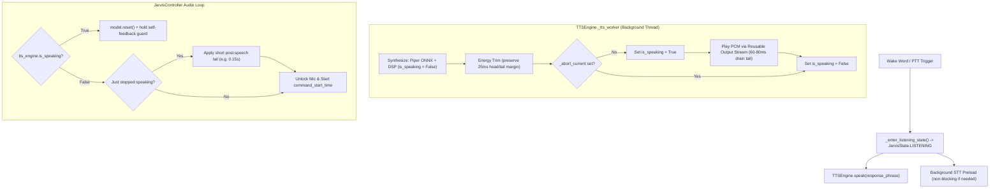

# Design Specification: Neural Voice Latency Hardening & Core Flow Resilience

**Date:** 2026-11-16  
**Status:** Implemented  
**Target:** `python-jarvis`

---

## 1. Overview & Problem Statement

Following the introduction of downloadable Piper ONNX neural voices and holographic DSP in v0.9.0, field usage revealed noticeable post-detection latency when using neural voices (e.g., `piper_sage`, `piper_dii`, `jarvis_mk3`, `friday_mk50`), as well as several minor lifecycle inconsistencies in the audio/controller and dispatcher layers:

1. **Excessive Post-Wake `"Ignoring Audio (Self-Feedback)"` Lockout (`tts_engine.py` & `controller.py`):**
   - `TTSEngine._tts_worker` sets `self.is_speaking = True` *before* loading the ONNX model, running `phonemize()`, executing VITS inference, and applying FFT/time-domain DSP. During this silent preparation phase, `JarvisController` already freezes microphone capture (`ignore_audio_until = now + 0.4`).
   - Many community Piper VITS checkpoints emit substantial trailing near-zero silence (often 300 ms–1,500 ms), compounded on short acknowledgments like `"Sim?"` by `length_scale *= 1.12` (`len(phonemes_str) <= 8`) and an unconditional `tail_silence = 200 ms` in `_play_pcm_int16()`.
   - Opening, draining (`stop_stream()`), and closing a fresh PyAudio output stream per sentence adds Windows audio driver overhead, and `controller.py` continuously extends `ignore_audio_until = now + 0.4` while `is_speaking` is `True`, adding another `400 ms` *after* playback drain finishes.
   - `command_start_time` is captured when `"Sim?"` is enqueued rather than when microphone capture actually unlocks, shrinking the effective `max_listening_seconds` window and risking clipped command beginnings.
2. **Intentional RAM vs. Performance-Profile Trade-Offs:**
   - Lazy loading of neural TTS models on boot is **intentional** to conserve RAM on standard profiles (`ultra_economic`, `economic`, `balanced`). Only the `performance` profile (`runtime.memory_optimization.lazy_load_secondary_modules == False`) should pre-warm the active neural voice on startup.
   - Similarly, keeping downloaded `.onnx` files on disk until the user explicitly triggers *"Enxugar Não Usadas"* is **intentional**; however, keeping *inactive* ONNX sessions pinned in RAM inside `TTSEngine._piper_cache` after previewing or switching voices is unnecessary when disk files remain untouched.
   - Using `Timing.UI_STABILIZATION_LONG` as the `_speech_queue.get(timeout=...)` interval in `_tts_worker` is **intentional** so lower-spec PCs follow preset timing scaling.
3. **Minor Core Flow Inconsistencies:**
   - **Synchronous STT Load in Audio Loop:** Waking from `SLEEPING` or `SUSPENDED` via PTT calls `stt_engine.load()` synchronously inside `JarvisController.start()`, blocking microphone frame reads.
   - **Duplicated `LISTENING` Transition:** Entering `LISTENING` is duplicated across four branches in `controller.py`.
   - **Redundant Error Speech in Command Palette:** `ActionDispatcher.dispatch()` catches `BusinessError` inside `except Exception`, speaking a generic error message right after a specific business prompt (e.g., empty replay history).

This specification defines targeted fixes for these issues while preserving all intentional memory-saving and hardware-compatibility behaviors.

---

## 2. Architecture & Data Flow

---

## 3. Core Component Specifications & Contracts

### 3.1 TTS Synthesis/Playback Decoupling & Silence Trimming (`core/audio/tts_engine.py`)

1. **Tight `is_speaking` Lifecycle:**
   - Keep `self.is_speaking = False` while pulling from `_speech_queue`, loading/caching the Piper model (`_get_or_load_piper`), phonemizing (`phonemize`), running ONNX inference, and running `apply_voice_dsp`.
   - Expose a race-free `has_pending_speech` property (`True` while queued, actively synthesizing, or playing) so `JarvisController` does not start capture/silence timers prematurely while a cold ONNX model loads or synthesizes.
   - Set `self.is_speaking = True` immediately before audio output starts (`_play_pcm_int16` or SAPI5 `voice.Speak`), wrapped in `try/finally` so `self.is_speaking` is guaranteed to return to `False` even on exceptions.
   - Re-check `self._abort_current.is_set()` right before setting `is_speaking = True` so an interrupted utterance never enters playback.
   - *Note:* Preserve `Timing.UI_STABILIZATION_LONG` for `self._speech_queue.get(timeout=...)`.

2. **Leading/Trailing Silence Trimming (`_trim_pcm_silence`):**
   - Add a pure helper `_trim_pcm_silence(pcm_int16, sample_rate, threshold=250, margin_ms=25.0) -> NDArray[np.int16]` applied to synthesized neural PCM before fade/padding:
     - Locate the first and last indices where `abs(sample) > threshold` (approx. `-42 dBFS`, safely above VITS numerical noise floor and quiet breath tails).
     - Preserve `margin_ms` (default `25 ms`) before the first active sample and after the last active sample so consonant bursts and natural vocal decay are never clipped.
     - If no sample exceeds `threshold`, return the array unchanged (or empty if size is 0) to avoid dropping ultra-quiet valid samples unexpectedly.
   - Reduce artificial `tail_silence` in `_play_pcm_int16` from `200 ms` to `70 ms` (paired with the existing `15 ms` fade-out and `50 ms` `lead_silence`)—sufficient for Windows audio driver draining without adding a perceptible 200 ms silent tail per utterance.
   - Review the short-utterance `length_scale` boost (`1.12x` when `len(phonemes_str) <= 8`): make it gentler (e.g., `1.04x` or remove when `rate >= 0`) so short wake phrases like `"Sim?"` stay natural and crisp without sounding sluggish.

3. **Output Stream Reuse in `_tts_worker`:**
   - Maintain a reusable output stream in `_tts_worker` keyed by `sample_rate` (closed and reopened only when `sample_rate` changes, on write error, or on worker shutdown/abort).
   - Wait for `stream.get_output_latency()` (bounded to `0.25s`) via `_abort_current.wait(...)` after writing all chunks on a reusable stream so hardware buffers drain before clearing `is_speaking`, while keeping `winsound.PlaySound` as fallback if PyAudio stream creation or writing fails.

4. **Profile-Aware Preload & Bounded RAM Cache (`_piper_cache`):**
   - **Startup Preload (`performance` profile only):** At the start of `_tts_worker`, check `config.get("runtime", {}).get("memory_optimization", {}).get("lazy_load_secondary_modules", True)`. Only when `False` (the `performance` preset) and `active_voice_id` uses `piper_onnx` and is already installed on disk, pre-warm `_get_or_load_piper` in the background TTS thread. Keep lazy-loading enabled for all other profiles.
   - **RAM Eviction Without Deleting Disk Files:** Bound `_piper_cache` to at most **1 active ONNX session** in RAM (or evict old `model_key`s when switching/previewing a different neural model), while **never** removing `.onnx` / `.onnx.json` files from `voices_dir`. Users retain full control over downloaded files on disk and when to run *"Enxugar Não Usadas"* in `SettingsTab`, while RAM usage stays capped at a single model (~60 MB).

---

### 3.2 Controller Anti-Feedback Timing & Listening Helpers (`core/controller.py`)

1. **Precise Post-Speech Self-Feedback Tail & Synthesis Guard:**
   - Track `self._was_speaking: bool = False` in `JarvisController`:
     - While `self.tts_engine.is_speaking` is `True`: reset `self.model.reset()` and set `self.ignore_audio_until = now + post_speech_guard_seconds` (configurable via `voice_activation.timeouts.post_speech_guard_seconds`, default `0.18s` instead of hard-coded `0.40s`), plus `self._was_speaking = True`.
     - When `is_speaking` transitions `True -> False`: perform a final `self.model.reset()`, refresh `self.ignore_audio_until = max(self.ignore_audio_until, now + post_speech_guard_seconds)` so 80 ms frame boundaries never shrink the guard window, and clear partial capture buffers/timers (`_reset_capture_windows`).
     - While `self.tts_engine.is_speaking` or `has_pending_speech is True`, skip `_handle_listening()` and `_handle_confirmation()` so cold ONNX synthesis never triggers premature silence timeouts (`silence_end_seconds` or `CONFIRMING_DRY_RUN` `0.5s` STT).
     - Anchor `self.command_start_time` on the first un-ignored frame entering `_handle_listening` so `max_listening_seconds` is never consumed by Jarvis's own response phrase.

2. **Unified `_enter_listening_state(timestamp: float)` Helper:**
   - Consolidate the repeated `LISTENING` entry sequence across:
     - `SLEEPING` PTT wakeup ([L199-L204](file:///C:/Programacao/python-jarvis/core/controller.py#L199-L204))
     - `_handle_suspended` PTT wakeup ([L452-L457](file:///C:/Programacao/python-jarvis/core/controller.py#L452-L457))
     - `_handle_idle` wakeword trigger ([L531-L536](file:///C:/Programacao/python-jarvis/core/controller.py#L531-L536))
     - `_handle_idle` PTT trigger ([L551-L556](file:///C:/Programacao/python-jarvis/core/controller.py#L551-L556))
   - Reset `self.command_frames = []`, `self.confirmation_frames = []`, `self.silence_start = None`, set `self.command_start_time = None` (initialized on first active listening frame after `ignore_audio_until`), speak `self.response_phrase`, and transition to `JarvisState.LISTENING`.

3. **Non-Blocking STT Preload on Wake from `SLEEPING` / `SUSPENDED`:**
   - Replace synchronous `stt_engine.load()` inside the real-time audio loop (`_handle_suspended` and `SLEEPING` PTT) with an asynchronous preload thread (`threading.Thread(target=stt_engine.load, daemon=True).start()`), keeping the PyAudio read loop responsive and preventing input buffer overflow.

---

### 3.3 Command Palette `BusinessError` Handling (`core/execution/dispatcher.py`)

- In `ActionDispatcher.dispatch()`, add an explicit `except BusinessError as be:` clause before `except Exception as e:`:
  - Log warning (`logger.warning(...)`), return `False` without overwriting the specific business TTS feedback (such as `"Não encontrei nenhuma ação recente para repetir."`) with `"Desculpe, ocorreu um erro ao processar sua instrução."`, and let `finally` return the state cleanly to `JarvisState.IDLE`.

---

## 4. Safety, Anti-Clipping & Anti-Self-Feedback Guardrails

Because shortening post-speech silence and `ignore_audio_until` directly trades off responsiveness against two failure modes—**clipping the end of Jarvis's spoken phrase** and **self-feedback false positives (re-triggering wakeword or capturing Jarvis's own `"Sim?"` inside `command_frames`)**—the implementation must enforce the following guardrails and tuning bounds:

| Risk | Mitigation / Guardrail | Verification Target |
| :--- | :--- | :--- |
| **Word / syllable clipping at end of phrase** | Keep `25 ms` active margin in `_trim_pcm_silence`, `15 ms` cosine/linear fade-out, and `70 ms` driver-drain `tail_silence`; test short (`"Sim?"`, `"Pronto!"`) and multi-sentence outputs across `sage`, `dii`, `jarvis_mk3`, `friday_mk50`, and `edresson`. | Zero audible cutoff on last syllable across all 8 neural models. |
| **Self-feedback captured in `command_frames` or re-triggering wake word** | Keep `self.model.reset()` active during `is_speaking` and on `True -> False` transition; maintain `post_speech_guard_seconds` (`0.15s–0.20s` default) as acoustic room-reverb buffer; keep `cooldown` reset on `EXECUTING/THINKING -> IDLE`. | Saying wake word -> `"Sim?"` -> silence must result in `no_speech_phrase` (not transcribing `"Sim?"`), and `"Pronto!"` after execution must not re-trigger wake word. |
| **Low-spec PC driver underruns / latency** | Keep `Timing.UI_STABILIZATION_LONG` for queue polling and keep `winsound` fallback if reusable PyAudio output stream throws; keep lazy-loading active on all profiles except `performance`. | Clean playback on `ultra_economic` / `balanced` profiles without PyAudio errors. |
| **Disk vs. RAM surprise for user** | RAM cache eviction only releases in-memory ONNX sessions; `.onnx` / `.onnx.json` files stay intact on disk until user clicks *"Enxugar Não Usadas"*. | Switching voices preserves `"✓"` installed status on disk while bounding RSS memory. |

---

## 5. Verification & Testing Plan

### 5.1 Automated Tests (Unit & Integration)
1. **`tests/unit/test_tts_engine.py`:**
   - Test `_trim_pcm_silence()` removes leading/trailing zeros while preserving `25 ms` margin and leaving non-silent audio intact.
   - Test `is_speaking` remains `False` during mocked `_synthesize_neural()` / `_get_or_load_piper()` and only flips to `True` during playback.
   - Test `_piper_cache` eviction bounds RAM to active model without deleting `.onnx` files on disk.
   - Test startup preload runs **only** when `lazy_load_secondary_modules` is `False` (`performance` profile).
2. **`tests/integration/test_controller.py`:**
   - Test `_enter_listening_state()` across wake word, PTT, `SLEEPING`, and `SUSPENDED` paths.
   - Test `command_start_time` starts after `ignore_audio_until` expires, preserving the full `max_listening_seconds` window.
   - Test `stt_engine.load()` on wake from `SLEEPING`/`SUSPENDED` does not block the controller loop.
3. **`tests/integration/test_dispatcher_replay.py`:**
   - Test `dispatch("repete")` with empty history raises/handles `BusinessError` cleanly without speaking the generic error message.

### 5.2 Manual Acoustic Validation (Real Microphone + Speakers)
Before merging implementation changes, run live speaker-to-mic checks (not just headphones) on at least `piper_sage`, `piper_dii`, `jarvis_mk3`, and `sapi5_default`:
1. **Wake-to-Listen Cutoff Check:** Say *"Hey Jarvis"* -> stay silent -> confirm `"Sim?"` finishes cleanly without clipped final syllable, `"Ignoring Audio"` releases quickly right after `"Sim?"` ends, and Jarvis finishes with `no_speech_phrase` (does **not** transcribe `"Sim?"` as a user command).
2. **Immediate Speech Capture Check:** Say *"Hey Jarvis"* -> immediately say *"que horas são"* as soon as `"Sim?"` ends -> confirm the first word (`"que"`) is captured cleanly by Whisper.
3. **Post-Completion Self-Trigger Check:** Execute a command that speaks `"Pronto!"` -> verify Jarvis returns to `IDLE` without re-triggering wake word from speaker echo.
4. **Profile RAM Check:** Confirm `balanced` does not preload ONNX on boot, whereas `performance` does; preview 3 neural voices in `SettingsTab` and verify RSS does not grow by 3×60 MB while all 3 remain installed (`✓`) on disk.
