# Design Specification: Obsidian Modals, Animated In-App Toasts & Hybrid Desktop Notifications

**Date:** 2026-11-17  
**Status:** Implemented (v0.10.0)  
**Target:** `python-jarvis`

---

## 1. Overview & Problem Statement

Prior to v0.10.0, Jarvis's user feedback surfaces suffered from visual inconsistency, geometric clipping, and noisy Windows notification spam:

1. **Broken In-App `InfoBar` Geometry in `640×500` Viewport:**
   - Standard `qfluentwidgets.InfoBar` popups anchored to inner tab widgets expanded horizontally past the `640×500` `MainWindow` bounds (measured offscreen at `1249×62 px`, starting at `x = -633, y = 24`), colliding with the `CustomTitleBar` and clipping text on settings changes.
2. **Inconsistent Modal Chrome & Tray Menu:**
   - `AudioCalibrationDialog` still used native Windows window borders instead of matching the frameless Obsidian aesthetic of `MainWindow` and `SecurityDialog`.
   - `CommandPaletteQt` lacked a cohesive rounded Obsidian outer shell (`#141416`) matching the rest of the UI, and the system tray `QMenu` fell back to default OS styling.
   - `CustomTitleBar` and `CloseTitleButton` were embedded inside `core/ui/main_window.py`, preventing clean reuse across frameless dialogs.
3. **Intrusive / Generic Windows Notifications & Voice Progress Spam:**
   - Background notifications relied on `plyer.notification.notify` without a custom app icon or fullscreen/lock-screen awareness, and intermediate voice stages (`"Processando áudio..."`, `"Entendi: ..."`, `"Pensando..."`) fired repetitive OS toasts even though `VoiceOverlayHUD` already displays real-time voice state.
4. **Inconsistent Portuguese Copywriting & Raw Technical Labels:**
   - Partial execution failure alerts still contained English text, provider names appeared unformatted (`"openai"`, `"openrouter"` instead of `"OpenAI"`, `"OpenRouter"`), and proactivity/microphone labels exposed internal config keys.

This specification defines the **Obsidian `JarvisToast` feedback system**, **shared frameless modal chrome**, **hybrid Desktop HUD + System Tray notification routing**, and **canonical Brazilian Portuguese copy formatters** delivered in v0.10.0.

---

## 2. Architecture & Data Flow

```mermaid
flowchart TD
    subgraph InAppFeedback ["In-App Settings & Plugins Feedback"]
        Trigger["SettingsTab / PluginsTab / AppController"] --> Helpers["show_success / show_info / show_warning / show_error"]
        Helpers --> ToastMgr["JarvisToastManager (max 3 stacked, anchored to parent.window())"]
        ToastMgr --> JToast["JarvisToast (Obsidian 1A, 310..470px, slide+fade in/out, hover pause)"]
    end

    subgraph FramelessChrome ["Shared Frameless Obsidian Chrome"]
        TitleBar["CustomTitleBar + CloseTitleButton (core/ui/widgets/title_bar.py)"]
        TitleBar --> MainWin["MainWindow"]
        TitleBar --> CalibDlg["AudioCalibrationDialog (Frameless #141416 + #19191d)"]
        Palette["CommandPaletteQt (#CommandPaletteShell #141416)"]
        TrayMenu["Styled Obsidian QMenu (#18191f)"]
    end

    subgraph HybridNotifications ["Thread-Safe Hybrid Desktop Notifications"]
        Caller["Any Thread (Worker / Dispatcher / Updater / Timer)"] --> Notifier["JarvisNotifier.notify(...)"]
        Notifier --> Bridge["NotificationBridge (Qt Signal -> UI Thread)"]
        Bridge --> Gate{"Screen Locked?"}
        Gate -->|Yes| Drop["Suppress Visual Display"]
        Gate -->|No| Mode{"mode == tray OR force_tray OR is_foreground_fullscreen()?"}
        Mode -->|Yes| TrayBalloon["QSystemTrayIcon.showMessage (Official Jarvis Icon)"]
        Mode -->|No| HUDMgr["DesktopNotificationManager (max 3 stacked, bottom-right)"]
        HUDMgr --> DesktopHUD["DesktopNotificationToast (WA_ShowWithoutActivating, progress bar, animated)"]
        Notifier -.->|"Fallback if Qt bridge inactive"| Plyer["plyer.notification (with Jarvis app_icon)"]
    end
```

---

## 3. Core Component Specifications & Contracts

### 3.1 Animated Obsidian In-App Toast (`core/ui/feedback.py`)
- **`JarvisToast` & `JarvisToastManager`:**
  - Always anchors to `parent.window()`, centered horizontally near the bottom edge (`BOTTOM_MARGIN = 16px`), bounded strictly within `[310px, 470px]` (clamped to parent window width) so it never clips or overlaps `CustomTitleBar`.
  - Obsidian surface (`rgba(24, 25, 32, 246)`, `1px solid rgba(255, 255, 255, 0.10)`, `10px` radius) with a `4px` semantic left accent bar (`#2ecc71` success, `#4cc2ff` info, `#f39c12` warning, `#ff3b5c` error).
  - Smooth entrance (`200ms OutCubic` vertical slide + opacity fade-in) and exit (`180ms InCubic` slide + fade-out via `dismiss()`, guarded by `_is_closing`), automatic pause on mouse hover, and vertical stacking of up to 3 concurrent toasts.
  - Public helpers (`show_success`, `show_info`, `show_warning`, `show_error`, `show_toast`) replace all `InfoBar` invocations across `settings_tab.py`, `plugins_tab.py`, and `app_controller.py`.
- **Canonical Copy Formatters (`core/ui/feedback.py`):**
  - `format_provider_name()` maps internal keys to canonical capitalization (`OpenAI`, `OpenRouter`, `DeepSeek`, `Gemini`, `Anthropic`).
  - `format_proactivity_label()` maps `"objective"` / `"proactive"` to human-readable Brazilian Portuguese (`"Objetiva"` / `"Proativa"`).

### 3.2 Unified Frameless Modals & Shared Title Bar
- **`core/ui/widgets/title_bar.py`:** Extracts `CustomTitleBar` and `CloseTitleButton` from `core/ui/main_window.py` with configurable title/button options for reuse in both `MainWindow` and frameless dialogs.
- **`core/ui/widgets/audio_calibration_dialog.py`:** Refactored to `Qt.WindowType.FramelessWindowHint | Qt.WindowType.Dialog` with `WA_TranslucentBackground`, `#141416` outer rounded shell (`12px` radius), draggable `CustomTitleBar`, and `#19191d` inner content card.
- **`core/ui/command_palette_qt.py`:** Encapsulates search input and results list inside `QFrame#CommandPaletteShell` (`#141416`, `12px` radius) with `#19191d` list surface and `#4cc2ff` active selection accent.
- **`core/ui/security_ui.py` & `core/ui/app_controller.py`:** Polishes the security countdown badge (`● Risco Elevado • Ns`) and applies rounded Obsidian styling (`#18191f`, `8px` radius, translucent blue hover) to the system tray `QMenu`.

### 3.3 Hybrid Windows Notification System (`core/ui/desktop_notifications.py` & `core/ui/notifications.py`)
- **`DesktopNotificationToast` & `DesktopNotificationManager` (`core/ui/desktop_notifications.py`):**
  - Renders non-intrusive bottom-right Obsidian notification cards using `WA_ShowWithoutActivating` and `WindowDoesNotAcceptFocus` so foreground applications never lose focus.
  - Supports animated entrance/exit, countdown progress bar, hover-to-pause, click callbacks (e.g., opening the Updates sub-tab when clicking an update alert), and stacking up to 3 simultaneous cards.
- **Thread-Safe Hybrid Router (`core/ui/notifications.py` & `core/activation.py`):**
  - `NotificationBridge` marshals notifications from worker threads onto the Qt main thread via Qt Signals.
  - Under default `notifications.mode: "hybrid"`:
    1. Suppresses notifications when `is_screen_locked()` is `True`.
    2. Routes to `QSystemTrayIcon.showMessage` (with the official Jarvis icon) when `force_tray=True`, `mode == "tray"`, or `is_foreground_fullscreen()` detects a fullscreen game/application.
    3. Displays `DesktopNotificationToast` otherwise, falling back to `plyer` (with Jarvis's `app_icon`) only if invoked before the Qt bridge is active.
- **Voice Progress Toast Gating & Settings UI (`config.yaml`, `core/infra/config.py`, `core/ui/tabs/settings_tab.py`, `core/execution/worker.py`, `core/execution/dispatcher.py`):**
  - Adds `notifications.mode` (`"hybrid" | "desktop_hud" | "tray"`) and `notifications.voice_progress_toasts` (`false` by default) so intermediate voice lifecycle statuses stay exclusively on `VoiceOverlayHUD` instead of spamming Windows notifications.
  - Exposes a dedicated **🔔 Notificações na Área de Trabalho** card in `SettingsTab` (`Tela & Voz`) with a notification style selector (`notification_mode_combo`), live preview button (`test_notification_btn`), and `voice_progress_toasts_switch`, persisting changes surgically to `config.yaml` and updating in-memory config immediately.

### 3.4 Brazilian Portuguese Copywriting Polish
- Migrates `StepExecutor.notify_partial_failure` (`core/execution/step_executor.py`) to `JarvisNotifier` in pt-BR (`"Jarvis — Aviso de Execução"`).
- Cleans up sleep-mode time display (`HH:MM`) in `core/ui/adapter.py` and completed timer alerts in `core/tools/timer_tool.py`.

---

## 4. Safety, Guardrails & Compatibility

| Guardrail | Mechanism | Purpose |
| :--- | :--- | :--- |
| **Zero Focus Stealing** | `WA_ShowWithoutActivating` + `WindowDoesNotAcceptFocus` | Ensures desktop notification cards never interrupt typing or gaming focus. |
| **Fullscreen & Lock-Screen Awareness** | `is_foreground_fullscreen()` & `is_screen_locked()` | Avoids overlaying custom Qt windows on fullscreen games and prevents leaking notification content on locked screens. |
| **Thread-Safe UI Delivery** | `NotificationBridge` Qt Signal | Guarantees all Qt widget creation and animations occur strictly on the main GUI thread. |
| **Pre-Boot Safe Fallback** | `plyer.notification` with `app_icon` | Preserves error reporting (e.g., `qt_exception_hook`) even before `QtAppController` mounts the notification bridge. |
| **Bounded Viewport Geometry** | `parent.window()` anchoring + `[310px, 470px]` clamp | Prevents in-app toasts from overflowing the `640×500` `MainWindow` or overlapping `CustomTitleBar`. |

---

## 5. Verification & Testing

1. **`tests/unit/test_ui_feedback_and_notifications.py`:** Covers `JarvisToast` clamping/stacking/dismiss animations, `format_provider_name` / `format_proactivity_label`, `DesktopNotificationToast` focus flags, and `JarvisNotifier` hybrid routing (`hybrid`, `tray`, `force_tray`, fullscreen redirect, lock-screen suppression, and `plyer` fallback).
2. **`tests/unit/test_dashboard_tabs.py`, `tests/unit/test_app_controller_integration.py`, `tests/unit/test_main_onboarding.py`, `tests/unit/test_worker.py`, `tests/integration/test_llm_tools_flow.py`:** Validates migrated toast helpers, tray menu styling, update-click navigation, and `voice_progress_toasts` gating.
3. **Offscreen Geometry Verification (`MainWindow 640×500`):** Confirmed `JarvisToast` renders at `325×78 px` (`x = 157, y = 406`), centered without clipping or title-bar overlap (down from `1249×62 px` at `x = -633, y = 24` with stock `InfoBar`).
