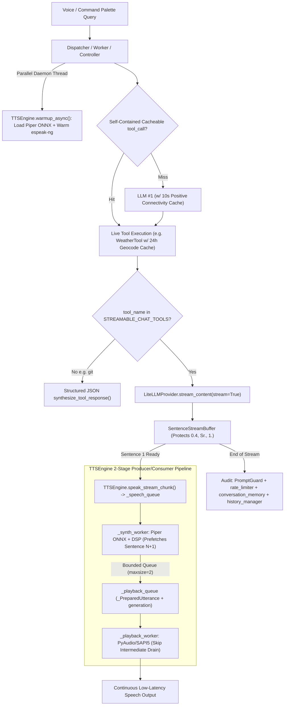

# Design Specification: LLM-to-TTS Voice Streaming, JIT Neural Warm-Up & Tool Latency Optimization

**Date:** 2026-11-20  
**Status:** Implemented (v0.10.0)  
**Target:** `python-jarvis`

---

## 1. Overview & Problem Statement

Forensic analysis of real-world production logs from the installed v0.9.1 binary (`C:\Jarvis`, voice `jarvis_mk3`, profile `auto` → `balanced`, provider `openrouter` / `google/gemini-2.5-flash`) combined with local ONNX benchmarks revealed a **~11.8-second** time-to-first-speech on informative tool queries such as `"vai chover hoje?"`, including a noticeable **~5.5-second silent blackout** *after* the tool and LLM had finished processing:

1. **Cold ONNX & `espeak-ng` Load Blocking Speech Start (~4.4s–5.8s):**
   - Under `balanced`/`economic` profiles (`lazy_load_secondary_modules: True`), `jarvis_mk3.onnx` (60.3 MB) is intentionally not preloaded on boot to conserve idle RAM.
   - However, loading `Piper(...)` (`3.95s` measured locally; ~4.5–5.0s cold disk) and initializing `espeak-ng` (`0.32s`) only began *after* LLM #1 + `WeatherTool` + LLM #2 had already completed sequentially.
   - Meanwhile, `ActionDispatcher.dispatch()` transitioned `THINKING -> IDLE` 9 ms after enqueueing text, and `TTSEngine` logged `"Jarvis is speaking"` *before* synthesis ran, hiding the ~5s delay while the UI disappeared and even transitioned `IDLE -> SUSPENDED` mid-synthesis.
2. **Non-Streaming JSON Synthesis on LLM #2 (`1.21s`):**
   - `LLMAgent.synthesize_tool_response()` invoked `litellm.completion(..., stream=False)` requiring strict JSON (`{"type": "chat", "message": "..."}`), blocking TTS until 100% of tokens were generated.
3. **Sequential TTS Synthesis & Playback (Inter-Sentence Gaps ~0.25s–0.45s):**
   - `TTSEngine._tts_worker()` synthesized and played sentences sequentially on a single thread (`synth S1 -> play S1 -> drain -> synth S2 -> play S2`) instead of prefetching Sentence N+1 while Sentence N plays.
4. **Redundant Network, Geocoding & Routing Overhead (`2.85s` LLM #1 + `1.99s` Weather):**
   - `WeatherTool._geocode()` performed a fresh HTTPS lookup (`~0.8s–1.0s`) on every weather request even for the static default city (`"Itamonte"`).
   - `check_internet_connection_async()` opened redundant TCP sockets before both LLM #1 and LLM #2 within the same turn.
   - `llm_cache` only cached `action` and `media` decisions, never self-contained read-only `tool_call` routing decisions (forcing a full `2.85s` LLM #1 roundtrip every time `"vai chover hoje?"` was asked).

This specification defines a 5-pillar architecture to cut cold time-to-first-speech by ~60–83% and eliminate the ~5s post-processing silent blackout while keeping **0 MB extra idle RAM on boot**.

---

## 2. Architecture & Data Flow

---

## 3. Core Component Specifications & Contracts

### 3.1 Just-in-Time (JIT) Parallel Voice Warm-Up (`core/audio/tts_engine.py`)
- **`TTSEngine.warmup_async()`:**
  - Idempotent, lock-guarded (`_warmup_lock` / `_warming_up`), no-op for SAPI5 voices or when both `_piper_cache[model_key]` and `_espeak_warmed` are already ready.
  - Loads the active Piper ONNX session via `_get_or_load_piper()` (logging exact `load_ms`) and initializes `espeak-ng` via `_warm_espeak_if_needed()` (guarded by `_phonemize_lock` so concurrent C-library calls cannot race).
  - Triggered upon entering LLM processing in `ActionDispatcher.dispatch()`, `ActionDispatcher.handle_tool_call()`, `worker._handle_llm()`, and `JarvisController._stop_listening_and_process()`.
  - Preserves 0 MB extra idle RAM on boot under `balanced`/`economic`/`ultra_economic` profiles while hiding the ~4.3s cold load behind concurrent network/LLM latency.

### 3.2 LLM-to-TTS Sentence Streaming (`core/llm/`, `core/ai/`, `core/execution/dispatcher.py`)
- **`BaseLLMProvider.stream_content()` & `LiteLLMProvider.stream_content()`:**
  - `BaseLLMProvider` defines `stream_content(prompt, system_instruction=None) -> Iterator[str]` with a backward-compatible default fallback to `generate_content()`.
  - `LiteLLMProvider.stream_content()` executes `litellm.completion(..., stream=True)`, extracts incremental deltas defensively across object/dict chunk shapes (`_extract_chunk_delta`), enforces offline/auth guards, and reports `"supports_streaming": True` in `get_capabilities()`.
- **`SentenceStreamBuffer` (`core/ai/sentence_buffer.py`):**
  - Incremental buffer (`push(delta)` / `flush()`) emitting complete sentences on `.`, `!`, `?`, and `\n` only when followed by whitespace, protecting decimals (`0.4`, `5.80`), Portuguese/English abbreviations (`Sr.`, `Dr.`, `etc.`), single-letter initials, numbered list markers (`1.`), and repeated punctuation (`...`, `?!`).
- **`LLMAgent.synthesize_tool_response(..., on_sentence=None)` (`core/ai/llm_agent.py`):**
  - Defines `STREAMABLE_CHAT_TOOLS` (`weather`, `finance`, `web_search`, `calculator`, `calendar`, `clipboard`, `notes`, `timer`, `youtube`, `github`, `dev_port`, `project_inspect`), explicitly excluding `git` so `git diff -> git_commit` remains on the structured JSON action path.
  - Streams plain spoken Portuguese through `_stream_with_fallback()` → `SentenceStreamBuffer` → `on_sentence` (calling `tts_engine.speak_stream_chunk()`), strips residual markdown wrappers (`_clean_spoken_sentence`), logs estimated tokens to `rate_limiter`, sanitizes via `PromptGuard.sanitize_output`, and marks `"_streamed": True`.
  - Automatically falls back to the structured JSON path if streaming fails before emitting any sentence; never switches providers mid-sentence after audio has started streaming.
- **Audit-Safe Deduplication (`core/execution/dispatcher.py`):**
  - `handle_tool_call()` pops `"_streamed"` and sets `_skip_tts_for_current_dynamic` in a `try/finally` around `handle_dynamic()` so `conversation_memory.record_turn()` and `history_manager.log_execution()` execute identically without speaking the full response a second time.

### 3.3 Two-Stage Producer/Consumer TTS Pipeline (`core/audio/tts_engine.py`)
- Decouples synthesis and playback into two daemon threads connected by `_playback_queue: queue.Queue[_PreparedUtterance]` (`maxsize=2`):
  - `_synth_worker` (producer): pulls text from `_speech_queue`, synthesizes PCM ahead of playback (`_prepare_utterance`), measures `synth_ms`, and enqueues `_PreparedUtterance` atomically under `_speech_state_lock`.
  - `_playback_worker` (consumer): logs real speech start with `[synth=...ms]` diagnostics (`_play_prepared_utterance`), plays audio via reusable PyAudio stream or SAPI5, and passes `drain=False` to `_play_pcm_int16()` whenever another utterance is already pending in the pipeline (draining `get_output_latency()` only at end-of-turn).
- **Generation Counter & Deterministic Preview Cleanup:**
  - `clear_queue()` atomically increments `_queue_generation` and drains both `_speech_queue` and `_playback_queue` under `_speech_state_lock`, guaranteeing in-flight synthesized audio from prior generations is discarded cleanly.
  - `_preview_voice_override` is cleared deterministically once preview items are consumed in `_synth_worker` (`_queued_count == 0`) as well as on normal `speak()` / `speak_stream_chunk()` calls.
  - Retains `_tts_worker()` delegating to the same helpers for synchronous unit-test compatibility.

### 3.4 Network, Geocoding & Selective `tool_call` Caches
- **Weather Geocoding Cache (`core/tools/weather_tool.py`):** Thread-safe (`_geocode_lock`) instance-level `_geocode_cache` with 24-hour TTL keyed by sanitized lowercase city name (`"Itamonte-MG"` and `"Itamonte"` share one entry), eliminating repeated geocoding HTTPS handshakes while keeping forecasts 100% live.
- **Short-TTL Connectivity Cache (`core/infra/network.py`):** Caches positive (`True`) default-endpoint connectivity checks for `10.0s` (`POSITIVE_CACHE_TTL_SECONDS`) with `reset_connectivity_cache()` for test isolation. Negative (`False`) results are never cached so reconnection is immediate.
- **Selective `tool_call` Routing Cache (`core/ai/llm_agent.py`):** `_is_cacheable_tool_call()` allows caching routing decisions only for read-only `CACHEABLE_TOOL_CALL_TOOLS` (`weather`, `finance`, `calculator`, `calendar`) on self-contained queries (`>= 2` tokens, no anaphoric/follow-up markers like `"e amanhã?"`, `"lá"`, `"nisso"`). Tool execution always runs live.

### 3.5 Controller State Coherence (`core/controller.py`)
- In `_handle_idle()`, checks `_is_tts_busy()` (`is_speaking` or `has_pending_speech`):
  - Displays `"Respondendo..."` instead of prematurely flipping back to `"Pronto"`/`"Cooldown"`.
  - Defers `IDLE -> SUSPENDED` transitions triggered by fullscreen detection while speech is pending/playing, while keeping immediate lock-screen (`context.is_screen_locked`) suspension strictly enforced.

---

## 4. Safety, Guardrails & Compatibility

| Guardrail | Mechanism | Purpose |
| :--- | :--- | :--- |
| **Zero Idle Boot RAM Regression** | `warmup_async()` triggered on demand | Preserves lazy loading on `balanced`/`economic` profiles while hiding cold ONNX load behind network I/O. |
| **Native `espeak-ng` Thread Safety** | `TTSEngine._phonemize_lock` | Prevents concurrent calls into the native `espeak-ng` library between JIT warm-up and `_synth_worker`. |
| **Race-Free Interruption** | `_queue_generation` + atomic `_speech_state_lock` | Discards stale in-flight synthesized PCM on `clear_queue()` and prevents `_prepared_count` drift. |
| **Action Plan Integrity** | `git` excluded from `STREAMABLE_CHAT_TOOLS` & `CACHEABLE_TOOL_CALL_TOOLS` | Ensures mutating/action-producing tools stay on structured JSON validation and `PromptGuard` / Dry-Run confirmation. |
| **Contextual Query Safety** | `_is_cacheable_tool_call()` token/prefix filter | Prevents follow-up queries (`"e amanhã?"`, `"como está lá?"`) from matching stale routing cache entries. |
| **Lock-Screen Privacy** | `if tts_busy and not context.is_screen_locked: return` | Never delays suspension when the Windows workstation is locked. |

---

## 5. Verification & Testing

All 688 automated tests pass (`uv run pytest`), alongside clean `ruff check`, `ruff format`, and `mypy core` (107 source files, 0 issues):

1. **`tests/unit/test_sentence_buffer.py` (4 tests):** Incremental splitting, decimal preservation (`0.4`, `5.80`), abbreviations (`Sr.`, `Dr.`), numbered lists, char-by-char deltas, and newlines.
2. **`tests/unit/test_tts_engine.py` (17 tests):** Idempotent `warmup_async()`, producer/consumer prefetching with `drain=[False, True]`, `speak_stream_chunk()` bypass of duplicate debounce, and `_queue_generation` invalidation on `clear_queue()`.
3. **`tests/unit/test_llm_provider.py` (4 tests) & `tests/unit/test_llm_agent.py` (15 tests):** `stream_content()` delta extraction, offline guards, `_is_cacheable_tool_call()` filtering, streaming tool synthesis, automatic JSON fallback on stream errors, and `git` structured JSON preservation.
4. **`tests/unit/test_weather_tool.py` (10 tests) & `tests/unit/test_network.py` (4 tests):** 24h geocoding cache hits across sanitized aliases and 10s positive-only connectivity cache.
5. **`tests/integration/test_llm_tools_flow.py` (14 tests) & `tests/integration/test_controller.py` (14 tests):** End-to-end `handle_tool_call` streaming without duplicate speech + full history/memory audit, and `"Respondendo..."` / deferred fullscreen suspend with immediate lock-screen suspend.
